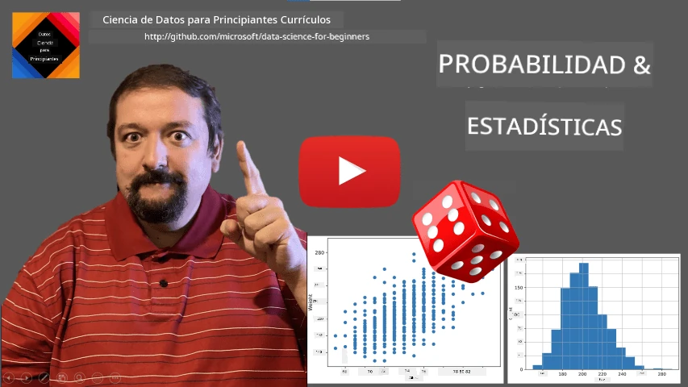
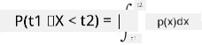
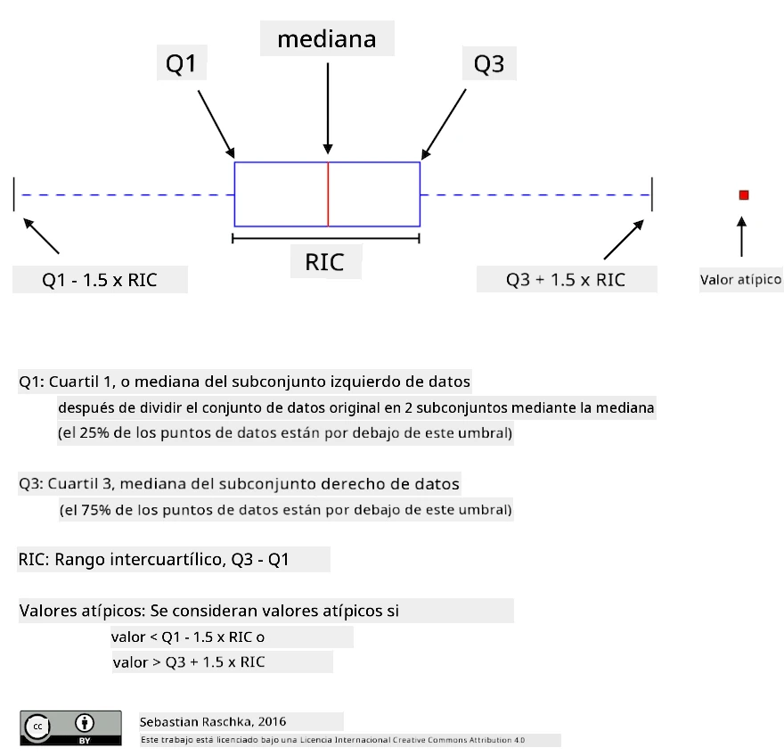
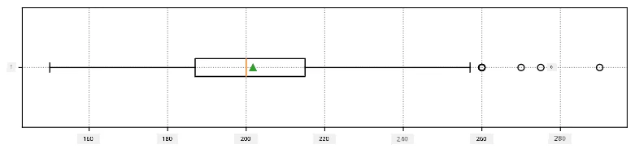
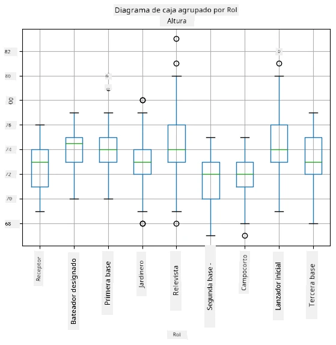
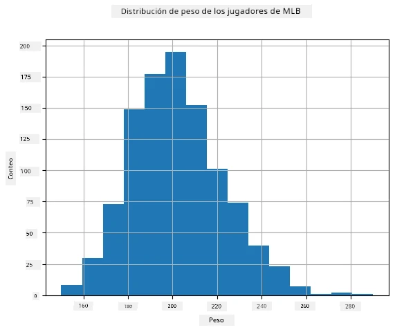
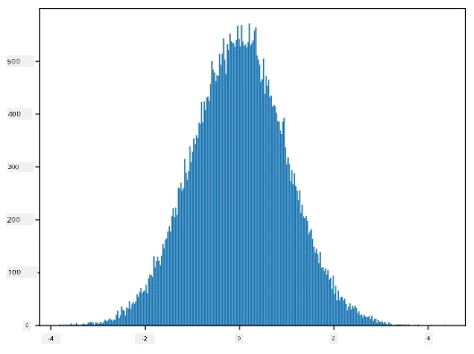
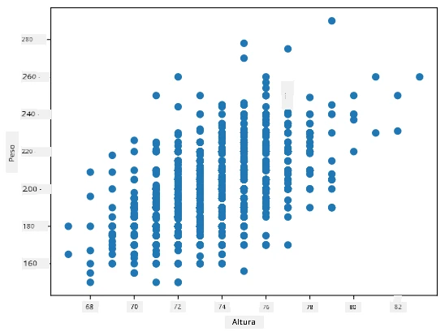

# Una Breve Introducción a Estadística y Probabilidad

| ](../../sketchnotes/04-Statistics-Probability.png)|
|:---:|
| Estadística y Probabilidad - _Sketchnote por [@nitya](https://twitter.com/nitya)_ |

La Teoría de Estadística y Probabilidad son dos áreas de las Matemáticas estrechamente relacionadas y altamente relevantes para la Ciencia de Datos. Es posible trabajar con datos sin un conocimiento profundo de matemáticas, pero siempre es mejor conocer al menos algunos conceptos básicos. Aquí presentaremos una breve introducción que te ayudará a comenzar.

[](https://youtu.be/Z5Zy85g4Yjw)

## [Cuestionario previo a la clase](https://ff-quizzes.netlify.app/quiz/6?loc=es)

## Probabilidad y Variables Aleatorias

**Probabilidad** es un número entre 0 y 1 que expresa cuán probable es que ocurra un **evento**. Se define como el número de resultados positivos (que conducen al evento), dividido por el número total de resultados, suponiendo que todos los resultados son igualmente probables. Por ejemplo, al lanzar un dado, la probabilidad de obtener un número par es 3/6 = 0.5.

Cuando hablamos de eventos, usamos **variables aleatorias**. Por ejemplo, la variable aleatoria que representa el número obtenido al lanzar un dado tomaría valores del 1 al 6. El conjunto de números del 1 al 6 se llama **espacio muestral**. Podemos hablar de la probabilidad de que una variable aleatoria tome un cierto valor, por ejemplo, P(X=3)=1/6.

La variable aleatoria en el ejemplo anterior se llama **discreta**, porque tiene un espacio muestral contable, es decir, hay valores separados que se pueden enumerar. Hay casos en los que el espacio muestral es un rango de números reales o el conjunto completo de números reales. Estas variables se llaman **continuas**. Un buen ejemplo es el tiempo de llegada de un autobús.

## Distribución de Probabilidad

En el caso de variables aleatorias discretas, es fácil describir la probabilidad de cada evento mediante una función P(X). Para cada valor *s* del espacio muestral *S*, dará un número entre 0 y 1, de modo que la suma de todos los valores de P(X=s) para todos los eventos sea 1.

La distribución discreta más conocida es la **distribución uniforme**, en la que hay un espacio muestral de N elementos, con una probabilidad igual de 1/N para cada uno de ellos.

Es más difícil describir la distribución de probabilidad de una variable continua, con valores tomados de algún intervalo [a,b], o del conjunto completo de números reales ℝ. Consideremos el caso del tiempo de llegada de un autobús. De hecho, para cada momento exacto de llegada *t*, ¡la probabilidad de que el autobús llegue exactamente en ese momento es 0!

> Ahora sabes que los eventos con probabilidad 0 ocurren, ¡y muy a menudo! ¡Al menos cada vez que llega el autobús!

Solo podemos hablar de la probabilidad de que una variable caiga en un intervalo dado de valores, por ejemplo, P(t<sub>1</sub>≤X<t<sub>2</sub>). En este caso, la distribución de probabilidad se describe mediante una **función de densidad de probabilidad** p(x), tal que



Un análogo continuo de la distribución uniforme se llama **uniforme continua**, que se define en un intervalo finito. La probabilidad de que el valor X caiga en un intervalo de longitud l es proporcional a l, y aumenta hasta 1.

Otra distribución importante es la **distribución normal**, de la que hablaremos con más detalle a continuación.

## Media, Varianza y Desviación Estándar

Supongamos que tomamos una secuencia de n muestras de una variable aleatoria X: x<sub>1</sub>, x<sub>2</sub>, ..., x<sub>n</sub>. Podemos definir la **media** (o **promedio aritmético**) de la secuencia de la manera tradicional como (x<sub>1</sub>+x<sub>2</sub>+x<sub>n</sub>)/n. A medida que aumentamos el tamaño de la muestra (es decir, tomamos el límite con n→∞), obtendremos la media (también llamada **esperanza**) de la distribución. Denotaremos la esperanza como **E**(x).

> Se puede demostrar que para cualquier distribución discreta con valores {x<sub>1</sub>, x<sub>2</sub>, ..., x<sub>N</sub>} y probabilidades correspondientes p<sub>1</sub>, p<sub>2</sub>, ..., p<sub>N</sub>, la esperanza sería igual a E(X)=x<sub>1</sub>p<sub>1</sub>+x<sub>2</sub>p<sub>2</sub>+...+x<sub>N</sub>p<sub>N</sub>.

Para identificar qué tan dispersos están los valores, podemos calcular la varianza σ<sup>2</sup> = ∑(x<sub>i</sub> - μ)<sup>2</sup>/n, donde μ es la media de la secuencia. El valor σ se llama **desviación estándar**, y σ<sup>2</sup> se llama **varianza**.

## Moda, Mediana y Cuartiles

A veces, la media no representa adecuadamente el valor "típico" de los datos. Por ejemplo, cuando hay algunos valores extremos que están completamente fuera de rango, pueden afectar la media. Otra buena indicación es la **mediana**, un valor tal que la mitad de los puntos de datos son menores que él, y la otra mitad son mayores.

Para ayudarnos a entender la distribución de los datos, es útil hablar de **cuartiles**:

* El primer cuartil, o Q1, es un valor tal que el 25% de los datos están por debajo de él.
* El tercer cuartil, o Q3, es un valor tal que el 75% de los datos están por debajo de él.

Gráficamente, podemos representar la relación entre la mediana y los cuartiles en un diagrama llamado **diagrama de caja**:



Aquí también calculamos el **rango intercuartílico** IQR=Q3-Q1, y los llamados **valores atípicos** - valores que están fuera de los límites [Q1-1.5*IQR, Q3+1.5*IQR].

Para una distribución finita que contiene un pequeño número de valores posibles, un buen valor "típico" es el que aparece con mayor frecuencia, llamado **moda**. A menudo se aplica a datos categóricos, como colores. Consideremos una situación en la que tenemos dos grupos de personas: algunos que prefieren fuertemente el rojo, y otros que prefieren el azul. Si codificamos los colores con números, el valor medio para un color favorito estaría en algún lugar del espectro naranja-verde, lo que no indica la preferencia real de ninguno de los grupos. Sin embargo, la moda sería uno de los colores, o ambos colores, si el número de personas que votan por ellos es igual (en este caso llamamos a la muestra **multimodal**).

## Datos del Mundo Real

Cuando analizamos datos del mundo real, a menudo no son variables aleatorias como tal, en el sentido de que no realizamos experimentos con resultados desconocidos. Por ejemplo, consideremos un equipo de jugadores de béisbol y sus datos corporales, como altura, peso y edad. Esos números no son exactamente aleatorios, pero aún podemos aplicar los mismos conceptos matemáticos. Por ejemplo, una secuencia de pesos de personas puede considerarse como una secuencia de valores tomados de alguna variable aleatoria. A continuación se muestra la secuencia de pesos de jugadores de béisbol reales de la [Major League Baseball](http://mlb.mlb.com/index.jsp), tomada de [este conjunto de datos](http://wiki.stat.ucla.edu/socr/index.php/SOCR_Data_MLB_HeightsWeights) (para tu conveniencia, solo se muestran los primeros 20 valores):

```
[180.0, 215.0, 210.0, 210.0, 188.0, 176.0, 209.0, 200.0, 231.0, 180.0, 188.0, 180.0, 185.0, 160.0, 180.0, 185.0, 197.0, 189.0, 185.0, 219.0]
```

> **Nota**: Para ver un ejemplo de cómo trabajar con este conjunto de datos, consulta el [notebook adjunto](notebook.ipynb). También hay una serie de desafíos a lo largo de esta lección, y puedes completarlos añadiendo algo de código a ese notebook. Si no estás seguro de cómo operar con datos, no te preocupes: volveremos a trabajar con datos usando Python más adelante. Si no sabes cómo ejecutar código en Jupyter Notebook, consulta [este artículo](https://soshnikov.com/education/how-to-execute-notebooks-from-github/).

Aquí está el diagrama de caja que muestra la media, mediana y cuartiles de nuestros datos:



Dado que nuestros datos contienen información sobre diferentes **roles** de jugadores, también podemos hacer el diagrama de caja por rol, lo que nos permitirá hacernos una idea de cómo varían los valores de los parámetros según los roles. Esta vez consideraremos la altura:



Este diagrama sugiere que, en promedio, la altura de los jugadores de primera base es mayor que la de los jugadores de segunda base. Más adelante en esta lección aprenderemos cómo podemos probar esta hipótesis de manera más formal y cómo demostrar que nuestros datos son estadísticamente significativos para mostrar esto.

> Al trabajar con datos del mundo real, asumimos que todos los puntos de datos son muestras tomadas de alguna distribución de probabilidad. Esta suposición nos permite aplicar técnicas de aprendizaje automático y construir modelos predictivos funcionales.

Para ver cuál es la distribución de nuestros datos, podemos trazar un gráfico llamado **histograma**. El eje X contendrá un número de diferentes intervalos de peso (los llamados **bins**), y el eje vertical mostrará el número de veces que nuestra muestra de variable aleatoria estuvo dentro de un intervalo dado.



En este histograma puedes ver que todos los valores están centrados alrededor de un cierto peso promedio, y cuanto más nos alejamos de ese peso, menos frecuentemente se encuentran pesos de ese valor. Es decir, es muy improbable que el peso de un jugador de béisbol sea muy diferente del peso promedio. La varianza de los pesos muestra la medida en que los pesos tienden a diferir del promedio.

> Si tomamos los pesos de otras personas, no de la liga de béisbol, es probable que la distribución sea diferente. Sin embargo, la forma de la distribución será la misma, pero la media y la varianza cambiarán. Por lo tanto, si entrenamos nuestro modelo con jugadores de béisbol, es probable que dé resultados incorrectos cuando se aplique a estudiantes de una universidad, porque la distribución subyacente es diferente.

## Distribución Normal

La distribución de pesos que hemos visto anteriormente es muy típica, y muchas mediciones del mundo real siguen el mismo tipo de distribución, pero con diferentes medias y varianzas. Esta distribución se llama **distribución normal**, y juega un papel muy importante en estadística.

Usar la distribución normal es una forma correcta de generar pesos aleatorios de posibles jugadores de béisbol. Una vez que conocemos el peso promedio `mean` y la desviación estándar `std`, podemos generar 1000 muestras de peso de la siguiente manera:
```python
samples = np.random.normal(mean,std,1000)
```

Si trazamos el histograma de las muestras generadas, veremos una imagen muy similar a la mostrada anteriormente. Y si aumentamos el número de muestras y el número de bins, podemos generar una imagen de una distribución normal más cercana al ideal:



*Distribución Normal con media=0 y desviación estándar=1*

## Intervalos de Confianza

Cuando hablamos de los pesos de los jugadores de béisbol, asumimos que existe una **variable aleatoria W** que corresponde a la distribución de probabilidad ideal de los pesos de todos los jugadores de béisbol (la llamada **población**). Nuestra secuencia de pesos corresponde a un subconjunto de todos los jugadores de béisbol que llamamos **muestra**. Una pregunta interesante es, ¿podemos conocer los parámetros de la distribución de W, es decir, la media y la varianza de la población?

La respuesta más sencilla sería calcular la media y la varianza de nuestra muestra. Sin embargo, podría suceder que nuestra muestra aleatoria no represente con precisión a toda la población. Por lo tanto, tiene sentido hablar de **intervalos de confianza**.

> **Intervalo de confianza** es la estimación de la verdadera media de la población dada nuestra muestra, que es precisa con una cierta probabilidad (o **nivel de confianza**).

Supongamos que tenemos una muestra X...

1</sub>, ..., X<sub>n</sub> de nuestra distribución. Cada vez que tomamos una muestra de nuestra distribución, obtendremos un valor medio μ diferente. Por lo tanto, μ puede considerarse una variable aleatoria. Un **intervalo de confianza** con confianza p es un par de valores (L<sub>p</sub>,R<sub>p</sub>), tal que **P**(L<sub>p</sub>≤μ≤R<sub>p</sub>) = p, es decir, la probabilidad de que el valor medio medido caiga dentro del intervalo es igual a p.

Va más allá de nuestra breve introducción discutir en detalle cómo se calculan esos intervalos de confianza. Se pueden encontrar más detalles [en Wikipedia](https://en.wikipedia.org/wiki/Confidence_interval). En resumen, definimos la distribución de la media muestral calculada en relación con la media verdadera de la población, lo que se llama **distribución t de Student**.

> **Dato interesante**: La distribución t de Student lleva ese nombre en honor al matemático William Sealy Gosset, quien publicó su artículo bajo el seudónimo "Student". Trabajaba en la cervecería Guinness y, según una de las versiones, su empleador no quería que el público supiera que utilizaban pruebas estadísticas para determinar la calidad de las materias primas.

Si queremos estimar la media μ de nuestra población con confianza p, necesitamos tomar el *percentil (1-p)/2* de una distribución t de Student A, que puede obtenerse de tablas o calcularse usando algunas funciones integradas de software estadístico (por ejemplo, Python, R, etc.). Entonces, el intervalo para μ sería dado por X±A*D/√n, donde X es la media obtenida de la muestra y D es la desviación estándar.

> **Nota**: También omitimos la discusión de un concepto importante de [grados de libertad](https://en.wikipedia.org/wiki/Degrees_of_freedom_(statistics)), que es relevante en relación con la distribución t de Student. Puedes consultar libros más completos sobre estadística para comprender este concepto en profundidad.

Un ejemplo de cálculo de intervalos de confianza para pesos y alturas se encuentra en los [notebooks adjuntos](notebook.ipynb).

| p    | Media del peso |
|------|----------------|
| 0.85 | 201.73±0.94    |
| 0.90 | 201.73±1.08    |
| 0.95 | 201.73±1.28    |

Observa que cuanto mayor es la probabilidad de confianza, más amplio es el intervalo de confianza.

## Pruebas de hipótesis

En nuestro conjunto de datos de jugadores de béisbol, hay diferentes roles de jugadores, que se pueden resumir a continuación (consulta el [notebook adjunto](notebook.ipynb) para ver cómo se calcula esta tabla):

| Rol               | Altura   | Peso     | Cantidad |
|-------------------|----------|----------|----------|
| Catcher           | 72.723684| 204.328947| 76       |
| Designated_Hitter | 74.222222| 220.888889| 18       |
| First_Baseman     | 74.000000| 213.109091| 55       |
| Outfielder        | 73.010309| 199.113402| 194      |
| Relief_Pitcher    | 74.374603| 203.517460| 315      |
| Second_Baseman    | 71.362069| 184.344828| 58       |
| Shortstop         | 71.903846| 182.923077| 52       |
| Starting_Pitcher  | 74.719457| 205.163636| 221      |
| Third_Baseman     | 73.044444| 200.955556| 45       |

Podemos notar que la altura media de los primera base es mayor que la de los segunda base. Por lo tanto, podríamos estar tentados a concluir que **los primera base son más altos que los segunda base**.

> Esta afirmación se llama **una hipótesis**, porque no sabemos si el hecho es realmente cierto o no.

Sin embargo, no siempre es obvio si podemos llegar a esta conclusión. Por la discusión anterior, sabemos que cada media tiene un intervalo de confianza asociado, y por lo tanto esta diferencia podría ser solo un error estadístico. Necesitamos una forma más formal de probar nuestra hipótesis.

Calculemos los intervalos de confianza por separado para las alturas de los primera y segunda base:

| Confianza | Primera Base | Segunda Base |
|-----------|--------------|--------------|
| 0.85      | 73.62..74.38 | 71.04..71.69 |
| 0.90      | 73.56..74.44 | 70.99..71.73 |
| 0.95      | 73.47..74.53 | 70.92..71.81 |

Podemos ver que en ningún nivel de confianza los intervalos se superponen. Esto prueba nuestra hipótesis de que los primera base son más altos que los segunda base.

Más formalmente, el problema que estamos resolviendo es ver si **dos distribuciones de probabilidad son iguales**, o al menos tienen los mismos parámetros. Dependiendo de la distribución, necesitamos usar diferentes pruebas para ello. Si sabemos que nuestras distribuciones son normales, podemos aplicar el **[t-test de Student](https://en.wikipedia.org/wiki/Student%27s_t-test)**.

En el t-test de Student, calculamos el llamado **valor t**, que indica la diferencia entre las medias, teniendo en cuenta la varianza. Se ha demostrado que el valor t sigue la **distribución t de Student**, lo que nos permite obtener el valor umbral para un nivel de confianza dado **p** (esto puede calcularse o consultarse en tablas numéricas). Luego comparamos el valor t con este umbral para aceptar o rechazar la hipótesis.

En Python, podemos usar el paquete **SciPy**, que incluye la función `ttest_ind` (además de muchas otras funciones estadísticas útiles). Esta función calcula el valor t por nosotros y también realiza la búsqueda inversa del valor de confianza p, de modo que solo necesitamos observar la confianza para sacar conclusiones.

Por ejemplo, nuestra comparación entre las alturas de los primera y segunda base nos da los siguientes resultados: 
```python
from scipy.stats import ttest_ind

tval, pval = ttest_ind(df.loc[df['Role']=='First_Baseman',['Height']], df.loc[df['Role']=='Designated_Hitter',['Height']],equal_var=False)
print(f"T-value = {tval[0]:.2f}\nP-value: {pval[0]}")
```
```
T-value = 7.65
P-value: 9.137321189738925e-12
```
En nuestro caso, el valor p es muy bajo, lo que significa que hay una fuerte evidencia que respalda que los primera base son más altos.

También hay otros tipos de hipótesis que podríamos querer probar, por ejemplo:
* Probar que una muestra dada sigue alguna distribución. En nuestro caso, hemos asumido que las alturas están distribuidas normalmente, pero eso necesita una verificación estadística formal.
* Probar que el valor medio de una muestra corresponde a un valor predefinido.
* Comparar las medias de varias muestras (por ejemplo, cuál es la diferencia en los niveles de felicidad entre diferentes grupos de edad).

## Ley de los grandes números y teorema central del límite

Una de las razones por las que la distribución normal es tan importante es el llamado **teorema central del límite**. Supongamos que tenemos una gran muestra de valores independientes N X<sub>1</sub>, ..., X<sub>N</sub>, muestreados de cualquier distribución con media μ y varianza σ<sup>2</sup>. Entonces, para un N suficientemente grande (en otras palabras, cuando N→∞), la media Σ<sub>i</sub>X<sub>i</sub> estará distribuida normalmente, con media μ y varianza σ<sup>2</sup>/N.

> Otra forma de interpretar el teorema central del límite es decir que, independientemente de la distribución, cuando calculas la media de una suma de valores de cualquier variable aleatoria, terminas con una distribución normal.

Del teorema central del límite también se deduce que, cuando N→∞, la probabilidad de que la media muestral sea igual a μ se convierte en 1. Esto se conoce como **la ley de los grandes números**.

## Covarianza y correlación

Una de las cosas que hace la ciencia de datos es encontrar relaciones entre datos. Decimos que dos secuencias **correlacionan** cuando exhiben un comportamiento similar al mismo tiempo, es decir, ambas suben/bajan simultáneamente, o una secuencia sube cuando la otra baja y viceversa. En otras palabras, parece haber alguna relación entre las dos secuencias.

> La correlación no necesariamente indica una relación causal entre dos secuencias; a veces ambas variables pueden depender de una causa externa, o puede ser pura coincidencia que las dos secuencias correlacionen. Sin embargo, una correlación matemática fuerte es una buena indicación de que dos variables están de alguna manera conectadas.

Matemáticamente, el concepto principal que muestra la relación entre dos variables aleatorias es la **covarianza**, que se calcula así: Cov(X,Y) = **E**\[(X-**E**(X))(Y-**E**(Y))\]. Calculamos la desviación de ambas variables respecto a sus valores medios, y luego el producto de esas desviaciones. Si ambas variables se desvían juntas, el producto será siempre un valor positivo, lo que sumará una covarianza positiva. Si ambas variables se desvían de forma desincronizada (es decir, una cae por debajo del promedio cuando la otra sube por encima del promedio), siempre obtendremos números negativos, que sumarán una covarianza negativa. Si las desviaciones no son dependientes, sumarán aproximadamente cero.

El valor absoluto de la covarianza no nos dice mucho sobre cuán grande es la correlación, porque depende de la magnitud de los valores reales. Para normalizarlo, podemos dividir la covarianza por la desviación estándar de ambas variables, para obtener la **correlación**. Lo bueno es que la correlación siempre está en el rango de [-1,1], donde 1 indica una fuerte correlación positiva entre los valores, -1 una fuerte correlación negativa, y 0 ninguna correlación en absoluto (las variables son independientes).

**Ejemplo**: Podemos calcular la correlación entre los pesos y las alturas de los jugadores de béisbol del conjunto de datos mencionado anteriormente:
```python
print(np.corrcoef(weights,heights))
```
Como resultado, obtenemos una **matriz de correlación** como esta:
```
array([[1.        , 0.52959196],
       [0.52959196, 1.        ]])
```

> La matriz de correlación C puede calcularse para cualquier número de secuencias de entrada S<sub>1</sub>, ..., S<sub>n</sub>. El valor de C<sub>ij</sub> es la correlación entre S<sub>i</sub> y S<sub>j</sub>, y los elementos diagonales siempre son 1 (que también es la autocorrelación de S<sub>i</sub>).

En nuestro caso, el valor 0.53 indica que hay cierta correlación entre el peso y la altura de una persona. También podemos hacer un gráfico de dispersión de un valor contra el otro para ver la relación visualmente:



> Más ejemplos de correlación y covarianza se pueden encontrar en el [notebook adjunto](notebook.ipynb).

## Conclusión

En esta sección, hemos aprendido:

* Propiedades estadísticas básicas de los datos, como media, varianza, moda y cuartiles.
* Diferentes distribuciones de variables aleatorias, incluida la distribución normal.
* Cómo encontrar correlación entre diferentes propiedades.
* Cómo usar un aparato matemático y estadístico sólido para probar algunas hipótesis.
* Cómo calcular intervalos de confianza para una variable aleatoria dada una muestra de datos.

Aunque esta no es una lista exhaustiva de temas dentro de la probabilidad y la estadística, debería ser suficiente para darte un buen comienzo en este curso.

## 🚀 Desafío

Usa el código de ejemplo en el notebook para probar otras hipótesis como: 
1. Los primera base son mayores que los segunda base.
2. Los primera base son más altos que los tercera base.
3. Los shortstops son más altos que los segunda base.

## [Cuestionario posterior a la lección](https://ff-quizzes.netlify.app/quiz/7?loc=es)

## Revisión y autoestudio

La probabilidad y la estadística son temas tan amplios que merecen su propio curso. Si estás interesado en profundizar en la teoría, puedes continuar leyendo algunos de los siguientes libros:

1. [Carlos Fernandez-Granda](https://cims.nyu.edu/~cfgranda/) de la Universidad de Nueva York tiene excelentes notas de clase [Probability and Statistics for Data Science](https://cims.nyu.edu/~cfgranda/pages/stuff/probability_stats_for_DS.pdf) (disponibles en línea).
1. [Peter y Andrew Bruce. Practical Statistics for Data Scientists.](https://www.oreilly.com/library/view/practical-statistics-for/9781491952955/) [[código de ejemplo en R](https://github.com/andrewgbruce/statistics-for-data-scientists)]. 
1. [James D. Miller. Statistics for Data Science](https://www.packtpub.com/product/statistics-for-data-science/9781788290678) [[código de ejemplo en R](https://github.com/PacktPublishing/Statistics-for-Data-Science)].

## Tarea

[Pequeño estudio sobre diabetes](assignment.md)

## Créditos

Esta lección ha sido creada con ♥️ por [Dmitry Soshnikov](http://soshnikov.com)
