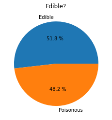
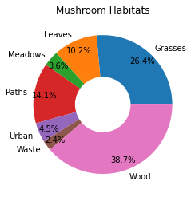
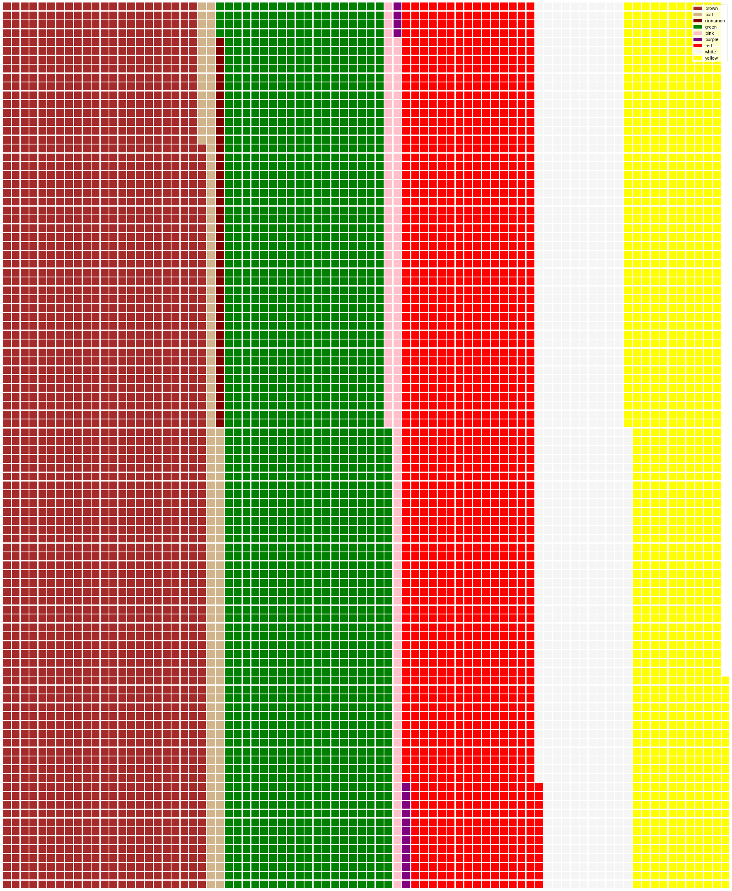

# Visualizando Proporciones

| ](../../sketchnotes/11-Visualizing-Proportions.png)|
|:---:|
|Visualizando Proporciones - _Sketchnote por [@nitya](https://twitter.com/nitya)_ |

En esta lección, usarás un conjunto de datos enfocado en la naturaleza para visualizar proporciones, como cuántos tipos diferentes de hongos se encuentran en un conjunto de datos sobre setas. Vamos a explorar estos fascinantes hongos utilizando un conjunto de datos obtenido de Audubon que detalla 23 especies de hongos con branquias de las familias Agaricus y Lepiota. Experimentarás con visualizaciones interesantes como:

- Gráficos de pastel 🥧  
- Gráficos de dona 🍩  
- Gráficos de waffle 🧇  

> 💡 Un proyecto muy interesante llamado [Charticulator](https://charticulator.com) de Microsoft Research ofrece una interfaz gratuita de arrastrar y soltar para visualizaciones de datos. En uno de sus tutoriales también utilizan este conjunto de datos de hongos. Así que puedes explorar los datos y aprender a usar la biblioteca al mismo tiempo: [Tutorial de Charticulator](https://charticulator.com/tutorials/tutorial4.html).

## [Cuestionario previo a la lección](https://ff-quizzes.netlify.app/quiz/20?loc=es)

## Conoce tus hongos 🍄

Los hongos son muy interesantes. Importemos un conjunto de datos para estudiarlos:

```python
import pandas as pd
import matplotlib.pyplot as plt
mushrooms = pd.read_csv('../../data/mushrooms.csv')
mushrooms.head()
```  
Se imprime una tabla con algunos datos excelentes para análisis:

| clase     | forma del sombrero | superficie del sombrero | color del sombrero | magulladuras | olor    | unión de las branquias | espacio entre branquias | tamaño de las branquias | color de las branquias | forma del tallo | raíz del tallo | superficie del tallo sobre el anillo | superficie del tallo bajo el anillo | color del tallo sobre el anillo | color del tallo bajo el anillo | tipo de velo | color del velo | número de anillos | tipo de anillo | color de impresión de esporas | población | hábitat |
| --------- | ------------------ | ----------------------- | ------------------ | ------------ | ------- | ---------------------- | ----------------------- | ----------------------- | ---------------------- | --------------- | ------------- | ---------------------------------- | ---------------------------------- | -------------------------------- | -------------------------------- | ----------- | ------------- | ----------------- | ------------- | ---------------------------- | ---------- | ------- |
| Venenoso  | Convexo            | Liso                   | Marrón            | Magulladuras | Pungente | Libre                  | Cerrado                | Estrecho               | Negro                 | Agrandado        | Igual         | Liso                               | Liso                               | Blanco                            | Blanco                            | Parcial     | Blanco        | Uno               | Colgante      | Negro                        | Disperso   | Urbano  |
| Comestible| Convexo            | Liso                   | Amarillo          | Magulladuras | Almendra | Libre                  | Cerrado                | Ancho                 | Negro                 | Agrandado        | Club          | Liso                               | Liso                               | Blanco                            | Blanco                            | Parcial     | Blanco        | Uno               | Colgante      | Marrón                       | Numeroso   | Pastos  |
| Comestible| Campana            | Liso                   | Blanco            | Magulladuras | Anís     | Libre                  | Cerrado                | Ancho                 | Marrón                | Agrandado        | Club          | Liso                               | Liso                               | Blanco                            | Blanco                            | Parcial     | Blanco        | Uno               | Colgante      | Marrón                       | Numeroso   | Praderas|
| Venenoso  | Convexo            | Escamoso               | Blanco            | Magulladuras | Pungente | Libre                  | Cerrado                | Estrecho              | Marrón                | Agrandado        | Igual         | Liso                               | Liso                               | Blanco                            | Blanco                            | Parcial     | Blanco        | Uno               | Colgante      | Negro                        | Disperso   | Urbano  |

De inmediato, notas que todos los datos son textuales. Tendrás que convertir estos datos para poder usarlos en un gráfico. De hecho, la mayoría de los datos están representados como un objeto:

```python
print(mushrooms.select_dtypes(["object"]).columns)
```  

El resultado es:

```output
Index(['class', 'cap-shape', 'cap-surface', 'cap-color', 'bruises', 'odor',
       'gill-attachment', 'gill-spacing', 'gill-size', 'gill-color',
       'stalk-shape', 'stalk-root', 'stalk-surface-above-ring',
       'stalk-surface-below-ring', 'stalk-color-above-ring',
       'stalk-color-below-ring', 'veil-type', 'veil-color', 'ring-number',
       'ring-type', 'spore-print-color', 'population', 'habitat'],
      dtype='object')
```  
Toma estos datos y convierte la columna 'clase' en una categoría:

```python
cols = mushrooms.select_dtypes(["object"]).columns
mushrooms[cols] = mushrooms[cols].astype('category')
```  

```python
edibleclass=mushrooms.groupby(['class']).count()
edibleclass
```  

Ahora, si imprimes los datos de los hongos, puedes ver que se han agrupado en categorías según la clase venenoso/comestible:

|           | forma del sombrero | superficie del sombrero | color del sombrero | magulladuras | olor | unión de las branquias | espacio entre branquias | tamaño de las branquias | color de las branquias | forma del tallo | ... | superficie del tallo bajo el anillo | color del tallo sobre el anillo | color del tallo bajo el anillo | tipo de velo | color del velo | número de anillos | tipo de anillo | color de impresión de esporas | población | hábitat |
| --------- | ------------------ | ----------------------- | ------------------ | ------------ | ---- | ---------------------- | ----------------------- | ----------------------- | ---------------------- | --------------- | --- | ---------------------------------- | -------------------------------- | -------------------------------- | ----------- | ------------- | ----------------- | ------------- | ---------------------------- | ---------- | ------- |
| clase     |                    |                         |                    |              |      |                        |                         |                         |                        |                 |     |                                  |                                |                                |             |               |                 |               |                            |            |         |
| Comestible| 4208               | 4208                   | 4208               | 4208         | 4208 | 4208                  | 4208                    | 4208                   | 4208                   | 4208            | ... | 4208                             | 4208                           | 4208                           | 4208         | 4208          | 4208             | 4208          | 4208                        | 4208       | 4208    |
| Venenoso  | 3916               | 3916                   | 3916               | 3916         | 3916 | 3916                  | 3916                    | 3916                   | 3916                   | 3916            | ... | 3916                             | 3916                           | 3916                           | 3916         | 3916          | 3916             | 3916          | 3916                        | 3916       | 3916    |

Si sigues el orden presentado en esta tabla para crear tus etiquetas de categoría de clase, puedes construir un gráfico de pastel:

## ¡Pastel!

```python
labels=['Edible','Poisonous']
plt.pie(edibleclass['population'],labels=labels,autopct='%.1f %%')
plt.title('Edible?')
plt.show()
```  
Voila, un gráfico de pastel que muestra las proporciones de estos datos según estas dos clases de hongos. Es bastante importante obtener el orden correcto de las etiquetas, especialmente aquí, así que asegúrate de verificar el orden con el que se construye el arreglo de etiquetas.



## ¡Donas!

Un gráfico de dona es un gráfico de pastel con un agujero en el medio, lo que lo hace visualmente más interesante. Veamos nuestros datos usando este método.

Observa los diversos hábitats donde crecen los hongos:

```python
habitat=mushrooms.groupby(['habitat']).count()
habitat
```  
Aquí, estás agrupando tus datos por hábitat. Hay 7 listados, así que usa esos como etiquetas para tu gráfico de dona:

```python
labels=['Grasses','Leaves','Meadows','Paths','Urban','Waste','Wood']

plt.pie(habitat['class'], labels=labels,
        autopct='%1.1f%%', pctdistance=0.85)
  
center_circle = plt.Circle((0, 0), 0.40, fc='white')
fig = plt.gcf()

fig.gca().add_artist(center_circle)
  
plt.title('Mushroom Habitats')
  
plt.show()
```  



Este código dibuja un gráfico y un círculo central, luego agrega ese círculo central al gráfico. Edita el ancho del círculo central cambiando `0.40` a otro valor.

Los gráficos de dona pueden ajustarse de varias maneras para cambiar las etiquetas. Las etiquetas, en particular, pueden destacarse para mejorar la legibilidad. Aprende más en los [docs](https://matplotlib.org/stable/gallery/pie_and_polar_charts/pie_and_donut_labels.html?highlight=donut).

Ahora que sabes cómo agrupar tus datos y luego mostrarlos como un gráfico de pastel o dona, puedes explorar otros tipos de gráficos. Prueba un gráfico de waffle, que es solo una forma diferente de explorar cantidades.

## ¡Waffles!

Un gráfico tipo 'waffle' es una forma diferente de visualizar cantidades como una matriz 2D de cuadrados. Intenta visualizar las diferentes cantidades de colores de sombrero de hongos en este conjunto de datos. Para hacerlo, necesitas instalar una biblioteca auxiliar llamada [PyWaffle](https://pypi.org/project/pywaffle/) y usar Matplotlib:

```python
pip install pywaffle
```  

Selecciona un segmento de tus datos para agrupar:

```python
capcolor=mushrooms.groupby(['cap-color']).count()
capcolor
```  

Crea un gráfico de waffle creando etiquetas y luego agrupando tus datos:

```python
import pandas as pd
import matplotlib.pyplot as plt
from pywaffle import Waffle
  
data ={'color': ['brown', 'buff', 'cinnamon', 'green', 'pink', 'purple', 'red', 'white', 'yellow'],
    'amount': capcolor['class']
     }
  
df = pd.DataFrame(data)
  
fig = plt.figure(
    FigureClass = Waffle,
    rows = 100,
    values = df.amount,
    labels = list(df.color),
    figsize = (30,30),
    colors=["brown", "tan", "maroon", "green", "pink", "purple", "red", "whitesmoke", "yellow"],
)
```  

Usando un gráfico de waffle, puedes ver claramente las proporciones de colores de sombrero en este conjunto de datos de hongos. ¡Curiosamente, hay muchos hongos con sombreros verdes!



✅ Pywaffle admite íconos dentro de los gráficos que utilizan cualquier ícono disponible en [Font Awesome](https://fontawesome.com/). Haz algunos experimentos para crear un gráfico de waffle aún más interesante usando íconos en lugar de cuadrados.

En esta lección, aprendiste tres formas de visualizar proporciones. Primero, necesitas agrupar tus datos en categorías y luego decidir cuál es la mejor manera de mostrar los datos: pastel, dona o waffle. Todos son deliciosos y gratifican al usuario con una instantánea instantánea de un conjunto de datos.

## 🚀 Desafío

Intenta recrear estos gráficos deliciosos en [Charticulator](https://charticulator.com).  
## [Cuestionario posterior a la lección](https://ff-quizzes.netlify.app/quiz/21?loc=es)

## Revisión y Autoestudio

A veces no es obvio cuándo usar un gráfico de pastel, dona o waffle. Aquí hay algunos artículos para leer sobre este tema:

https://www.beautiful.ai/blog/battle-of-the-charts-pie-chart-vs-donut-chart  

https://medium.com/@hypsypops/pie-chart-vs-donut-chart-showdown-in-the-ring-5d24fd86a9ce  

https://www.mit.edu/~mbarker/formula1/f1help/11-ch-c6.htm  

https://medium.datadriveninvestor.com/data-visualization-done-the-right-way-with-tableau-waffle-chart-fdf2a19be402  

Investiga más para encontrar información sobre esta decisión complicada.

## Tarea

[Inténtalo en Excel](assignment.md)
