# Ciencia de Datos en la Nube: El enfoque "Low code/No code"

| ](../../sketchnotes/18-DataScience-Cloud.png)|
|:---:|
| Ciencia de Datos en la Nube: Low Code - _Sketchnote por [@nitya](https://twitter.com/nitya)_ |

Tabla de contenidos:

- [Ciencia de Datos en la Nube: El enfoque "Low code/No code"](../../5-Data-Science-In-Cloud/18-Low-Code)
  - [Cuestionario previo a la clase](../../5-Data-Science-In-Cloud/18-Low-Code)
  - [1. Introducción](../../5-Data-Science-In-Cloud/18-Low-Code)
    - [1.1 ¿Qué es Azure Machine Learning?](../../5-Data-Science-In-Cloud/18-Low-Code)
    - [1.2 El Proyecto de Predicción de Insuficiencia Cardíaca:](../../5-Data-Science-In-Cloud/18-Low-Code)
    - [1.3 El Conjunto de Datos de Insuficiencia Cardíaca:](../../5-Data-Science-In-Cloud/18-Low-Code)
  - [2. Entrenamiento Low code/No code de un modelo en Azure ML Studio](../../5-Data-Science-In-Cloud/18-Low-Code)
    - [2.1 Crear un espacio de trabajo en Azure ML](../../5-Data-Science-In-Cloud/18-Low-Code)
    - [2.2 Recursos de Cómputo](../../5-Data-Science-In-Cloud/18-Low-Code)
      - [2.2.1 Elegir las opciones correctas para tus recursos de cómputo](../../5-Data-Science-In-Cloud/18-Low-Code)
      - [2.2.2 Crear un clúster de cómputo](../../5-Data-Science-In-Cloud/18-Low-Code)
    - [2.3 Cargar el conjunto de datos](../../5-Data-Science-In-Cloud/18-Low-Code)
    - [2.4 Entrenamiento Low code/No code con AutoML](../../5-Data-Science-In-Cloud/18-Low-Code)
  - [3. Despliegue del modelo Low code/No code y consumo del endpoint](../../5-Data-Science-In-Cloud/18-Low-Code)
    - [3.1 Despliegue del modelo](../../5-Data-Science-In-Cloud/18-Low-Code)
    - [3.2 Consumo del endpoint](../../5-Data-Science-In-Cloud/18-Low-Code)
  - [🚀 Desafío](../../5-Data-Science-In-Cloud/18-Low-Code)
  - [Cuestionario posterior a la clase](../../5-Data-Science-In-Cloud/18-Low-Code)
  - [Revisión y Autoestudio](../../5-Data-Science-In-Cloud/18-Low-Code)
  - [Tarea](../../5-Data-Science-In-Cloud/18-Low-Code)
  
## [Cuestionario previo a la clase](https://ff-quizzes.netlify.app/quiz/34?loc=es)

## 1. Introducción
### 1.1 ¿Qué es Azure Machine Learning?

La plataforma de nube Azure incluye más de 200 productos y servicios diseñados para ayudarte a dar vida a nuevas soluciones. Los científicos de datos dedican mucho esfuerzo a explorar y preprocesar datos, así como a probar diversos algoritmos de entrenamiento de modelos para producir modelos precisos. Estas tareas consumen tiempo y, a menudo, hacen un uso ineficiente de hardware de cómputo costoso.

[Azure ML](https://docs.microsoft.com/azure/machine-learning/overview-what-is-azure-machine-learning?WT.mc_id=academic-77958-bethanycheum&ocid=AID3041109) es una plataforma basada en la nube para construir y operar soluciones de aprendizaje automático en Azure. Incluye una amplia gama de características y capacidades que ayudan a los científicos de datos a preparar datos, entrenar modelos, publicar servicios predictivos y monitorear su uso. Lo más importante es que les permite aumentar su eficiencia al automatizar muchas de las tareas que consumen tiempo en el entrenamiento de modelos, y les permite usar recursos de cómputo basados en la nube que escalan de manera efectiva para manejar grandes volúmenes de datos, incurriendo en costos solo cuando se utilizan.

Azure ML proporciona todas las herramientas que los desarrolladores y científicos de datos necesitan para sus flujos de trabajo de aprendizaje automático. Estas incluyen:

- **Azure Machine Learning Studio**: un portal web en Azure Machine Learning para opciones de entrenamiento, despliegue, automatización, seguimiento y gestión de activos con poco o ningún código. El estudio se integra con el SDK de Azure Machine Learning para una experiencia fluida.
- **Jupyter Notebooks**: para prototipar y probar rápidamente modelos de aprendizaje automático.
- **Azure Machine Learning Designer**: permite arrastrar y soltar módulos para construir experimentos y luego desplegar pipelines en un entorno de bajo código.
- **Interfaz de AutoML**: automatiza tareas iterativas del desarrollo de modelos de aprendizaje automático, permitiendo construir modelos con alta escala, eficiencia y productividad, manteniendo la calidad del modelo.
- **Etiquetado de datos**: una herramienta asistida de aprendizaje automático para etiquetar datos automáticamente.
- **Extensión de aprendizaje automático para Visual Studio Code**: proporciona un entorno de desarrollo completo para construir y gestionar proyectos de aprendizaje automático.
- **CLI de aprendizaje automático**: comandos para gestionar recursos de Azure ML desde la línea de comandos.
- **Integración con frameworks de código abierto** como PyTorch, TensorFlow, Scikit-learn y muchos más para entrenar, desplegar y gestionar el proceso de aprendizaje automático de principio a fin.
- **MLflow**: una biblioteca de código abierto para gestionar el ciclo de vida de tus experimentos de aprendizaje automático. **MLFlow Tracking** es un componente de MLflow que registra y rastrea las métricas de tus entrenamientos y los artefactos del modelo, independientemente del entorno de tu experimento.

### 1.2 El Proyecto de Predicción de Insuficiencia Cardíaca:

No hay duda de que crear y construir proyectos es la mejor manera de poner a prueba tus habilidades y conocimientos. En esta lección, vamos a explorar dos formas diferentes de construir un proyecto de ciencia de datos para la predicción de ataques de insuficiencia cardíaca en Azure ML Studio, a través de Low code/No code y mediante el SDK de Azure ML, como se muestra en el siguiente esquema:


Cada enfoque tiene sus propias ventajas y desventajas. El enfoque Low code/No code es más fácil para comenzar, ya que implica interactuar con una interfaz gráfica (GUI), sin necesidad de conocimientos previos de programación. Este método permite probar rápidamente la viabilidad del proyecto y crear un POC (Prueba de Concepto). Sin embargo, a medida que el proyecto crece y necesita estar listo para producción, no es factible crear recursos a través de la GUI. Es necesario automatizar todo programáticamente, desde la creación de recursos hasta el despliegue de un modelo. Aquí es donde saber usar el SDK de Azure ML se vuelve crucial.

|                   | Low code/No code | SDK de Azure ML           |
|-------------------|------------------|---------------------------|
| Experiencia en código | No requerida     | Requerida                  |
| Tiempo de desarrollo   | Rápido y fácil   | Depende de la experiencia en código |
| Listo para producción  | No               | Sí                        |

### 1.3 El Conjunto de Datos de Insuficiencia Cardíaca: 

Las enfermedades cardiovasculares (ECV) son la principal causa de muerte a nivel mundial, representando el 31% de todas las muertes. Factores de riesgo ambientales y conductuales como el uso de tabaco, dieta poco saludable y obesidad, inactividad física y consumo nocivo de alcohol podrían usarse como características para modelos de estimación. Poder estimar la probabilidad de desarrollar una ECV podría ser de gran utilidad para prevenir ataques en personas de alto riesgo.

Kaggle ha puesto a disposición pública un [conjunto de datos de insuficiencia cardíaca](https://www.kaggle.com/andrewmvd/heart-failure-clinical-data) que vamos a usar para este proyecto. Puedes descargar el conjunto de datos ahora. Este es un conjunto de datos tabular con 13 columnas (12 características y 1 variable objetivo) y 299 filas. 

|    | Nombre de la variable      | Tipo            | Descripción                                               | Ejemplo           |
|----|---------------------------|-----------------|-----------------------------------------------------------|-------------------|
| 1  | age                       | numérica        | Edad del paciente                                         | 25                |
| 2  | anaemia                   | booleana        | Disminución de glóbulos rojos o hemoglobina               | 0 o 1             |
| 3  | creatinine_phosphokinase  | numérica        | Nivel de la enzima CPK en la sangre                       | 542               |
| 4  | diabetes                  | booleana        | Si el paciente tiene diabetes                             | 0 o 1             |
| 5  | ejection_fraction         | numérica        | Porcentaje de sangre que sale del corazón en cada contracción | 45                |
| 6  | high_blood_pressure       | booleana        | Si el paciente tiene hipertensión                         | 0 o 1             |
| 7  | platelets                 | numérica        | Plaquetas en la sangre                                    | 149000            |
| 8  | serum_creatinine          | numérica        | Nivel de creatinina sérica en la sangre                   | 0.5               |
| 9  | serum_sodium              | numérica        | Nivel de sodio sérico en la sangre                        | jun               |
| 10 | sex                       | booleana        | Mujer u hombre                                            | 0 o 1             |
| 11 | smoking                   | booleana        | Si el paciente fuma                                       | 0 o 1             |
| 12 | time                      | numérica        | Período de seguimiento (días)                             | 4                 |
|----|---------------------------|-----------------|-----------------------------------------------------------|-------------------|
| 21 | DEATH_EVENT [Objetivo]    | booleana        | Si el paciente muere durante el período de seguimiento    | 0 o 1             |

Una vez que tengas el conjunto de datos, podemos comenzar el proyecto en Azure.

## 2. Entrenamiento Low code/No code de un modelo en Azure ML Studio
### 2.1 Crear un espacio de trabajo en Azure ML
Para entrenar un modelo en Azure ML, primero necesitas crear un espacio de trabajo en Azure ML. El espacio de trabajo es el recurso de nivel superior para Azure Machine Learning, proporcionando un lugar centralizado para trabajar con todos los artefactos que creas al usar Azure Machine Learning. El espacio de trabajo mantiene un historial de todas las ejecuciones de entrenamiento, incluyendo registros, métricas, resultados y una instantánea de tus scripts. Usas esta información para determinar qué ejecución de entrenamiento produce el mejor modelo. [Aprende más](https://docs.microsoft.com/azure/machine-learning/concept-workspace?WT.mc_id=academic-77958-bethanycheum&ocid=AID3041109)

Se recomienda usar el navegador más actualizado que sea compatible con tu sistema operativo. Los siguientes navegadores son compatibles:

- Microsoft Edge (La nueva versión de Microsoft Edge, no la versión heredada)
- Safari (última versión, solo Mac)
- Chrome (última versión)
- Firefox (última versión)

Para usar Azure Machine Learning, crea un espacio de trabajo en tu suscripción de Azure. Luego puedes usar este espacio de trabajo para gestionar datos, recursos de cómputo, código, modelos y otros artefactos relacionados con tus cargas de trabajo de aprendizaje automático.

> **_NOTA:_** Tu suscripción de Azure se cobrará una pequeña cantidad por almacenamiento de datos mientras el espacio de trabajo de Azure Machine Learning exista en tu suscripción, por lo que te recomendamos eliminar el espacio de trabajo de Azure Machine Learning cuando ya no lo estés utilizando.

1. Inicia sesión en el [portal de Azure](https://ms.portal.azure.com/) usando las credenciales de Microsoft asociadas con tu suscripción de Azure.
2. Selecciona **＋Crear un recurso**
   
   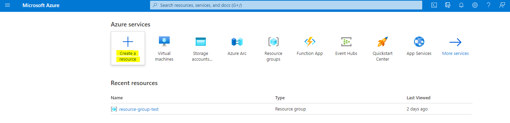

   Busca Machine Learning y selecciona el mosaico de Machine Learning

   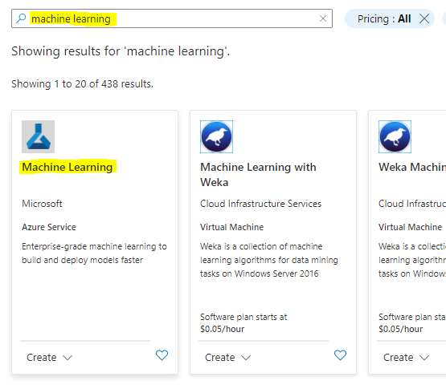

   Haz clic en el botón de crear

   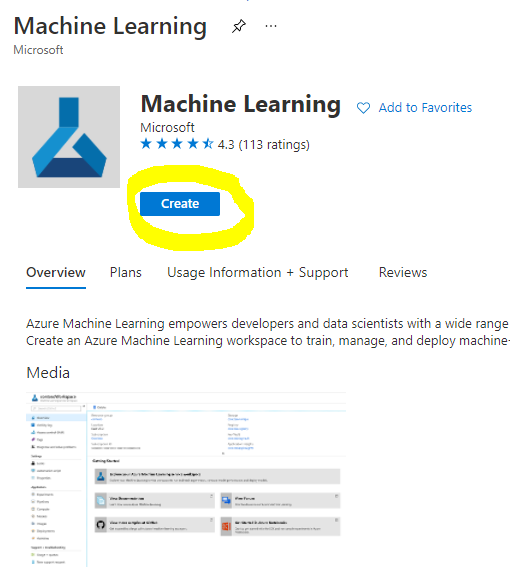

   Completa la configuración como sigue:
   - Suscripción: Tu suscripción de Azure
   - Grupo de recursos: Crea o selecciona un grupo de recursos
   - Nombre del espacio de trabajo: Ingresa un nombre único para tu espacio de trabajo
   - Región: Selecciona la región geográfica más cercana a ti
   - Cuenta de almacenamiento: Nota la nueva cuenta de almacenamiento predeterminada que se creará para tu espacio de trabajo
   - Key vault: Nota el nuevo key vault predeterminado que se creará para tu espacio de trabajo
   - Application insights: Nota el nuevo recurso de application insights predeterminado que se creará para tu espacio de trabajo
   - Registro de contenedor: Ninguno (se creará automáticamente la primera vez que despliegues un modelo en un contenedor)

    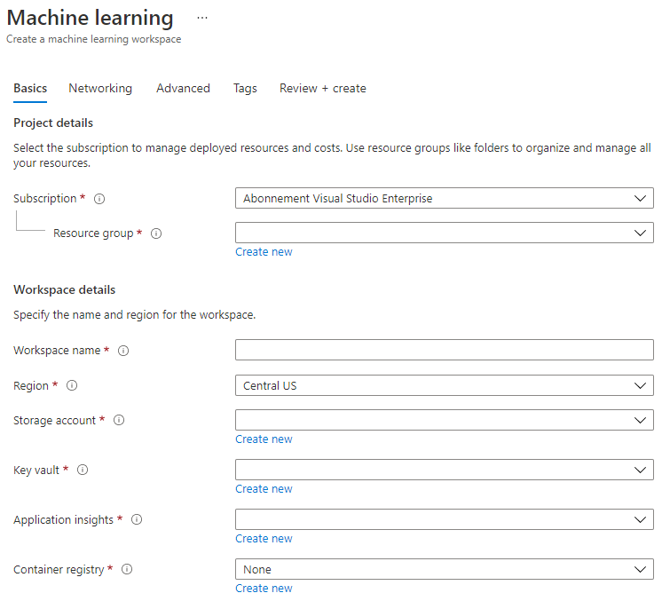

   - Haz clic en crear + revisar y luego en el botón de crear
3. Espera a que se cree tu espacio de trabajo (esto puede tomar unos minutos). Luego ve a él en el portal. Puedes encontrarlo a través del servicio de Machine Learning de Azure.
4. En la página de resumen de tu espacio de trabajo, lanza Azure Machine Learning studio (o abre una nueva pestaña del navegador y navega a https://ml.azure.com), e inicia sesión en Azure Machine Learning studio usando tu cuenta de Microsoft. Si se te solicita, selecciona tu directorio y suscripción de Azure, y tu espacio de trabajo de Azure Machine Learning.
   
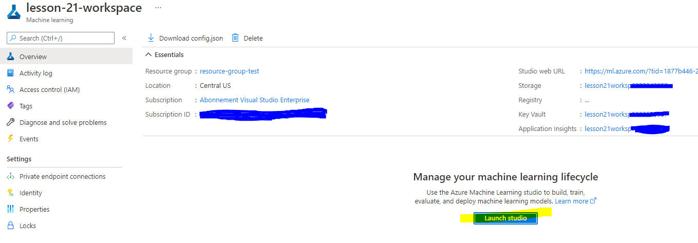

5. En Azure Machine Learning studio, alterna el ícono ☰ en la parte superior izquierda para ver las diferentes páginas de la interfaz. Puedes usar estas páginas para gestionar los recursos en tu espacio de trabajo.

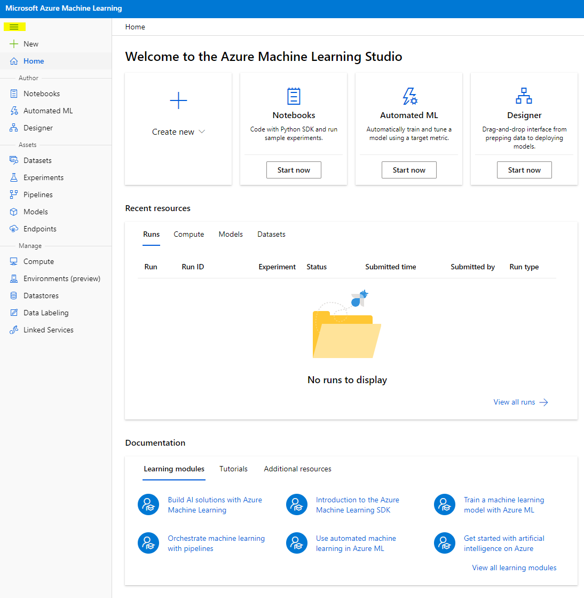

Puedes gestionar tu espacio de trabajo usando el portal de Azure, pero para los científicos de datos e ingenieros de operaciones de aprendizaje automático, Azure Machine Learning Studio proporciona una interfaz de usuario más enfocada para gestionar los recursos del espacio de trabajo.

### 2.2 Recursos de Cómputo

Los Recursos de Cómputo son recursos basados en la nube en los que puedes ejecutar procesos de entrenamiento de modelos y exploración de datos. Hay cuatro tipos de recursos de cómputo que puedes crear:

- **Instancias de Cómputo**: Estaciones de trabajo de desarrollo que los científicos de datos pueden usar para trabajar con datos y modelos. Esto implica la creación de una Máquina Virtual (VM) y el lanzamiento de una instancia de notebook. Luego puedes entrenar un modelo llamando a un clúster de cómputo desde el notebook.
- **Clústeres de Cómputo**: Clústeres escalables de VMs para el procesamiento bajo demanda de código de experimentos. Los necesitarás al entrenar un modelo. Los clústeres de cómputo también pueden emplear recursos especializados de GPU o CPU.
- **Clústeres de Inferencia**: Objetivos de despliegue para servicios predictivos que usan tus modelos entrenados.
- **Compute adjunto**: Enlaces a recursos de cómputo existentes en Azure, como máquinas virtuales o clústeres de Azure Databricks.

#### 2.2.1 Elegir las opciones correctas para tus recursos de cómputo

Hay algunos factores clave a considerar al crear un recurso de cómputo, y esas decisiones pueden ser críticas.

**¿Necesitas CPU o GPU?**

Una CPU (Unidad Central de Procesamiento) es el circuito electrónico que ejecuta las instrucciones de un programa informático. Una GPU (Unidad de Procesamiento Gráfico) es un circuito electrónico especializado que puede ejecutar código relacionado con gráficos a una velocidad muy alta.

La principal diferencia entre la arquitectura de CPU y GPU es que una CPU está diseñada para manejar una amplia gama de tareas rápidamente (medido por la velocidad del reloj de la CPU), pero está limitada en la concurrencia de tareas que pueden ejecutarse. Las GPUs están diseñadas para la computación paralela y, por lo tanto, son mucho mejores para tareas de aprendizaje profundo.

| CPU                                     | GPU                         |
|-----------------------------------------|-----------------------------|
| Menos costosa                           | Más costosa                 |
| Nivel de concurrencia más bajo          | Nivel de concurrencia más alto |
| Más lenta en el entrenamiento de modelos de aprendizaje profundo | Óptima para aprendizaje profundo |

**Tamaño del clúster**

Los clústeres más grandes son más costosos pero ofrecen mejor capacidad de respuesta. Por lo tanto, si tienes tiempo pero no suficiente dinero, deberías comenzar con un clúster pequeño. Por el contrario, si tienes dinero pero no mucho tiempo, deberías comenzar con un clúster más grande.

**Tamaño de la máquina virtual (VM)**

Dependiendo de tus restricciones de tiempo y presupuesto, puedes variar el tamaño de tu RAM, disco, número de núcleos y velocidad del reloj. Incrementar todos esos parámetros será más costoso, pero resultará en un mejor rendimiento.

**¿Instancias dedicadas o de baja prioridad?**

Una instancia de baja prioridad significa que es interrumpible: esencialmente, Microsoft Azure puede tomar esos recursos y asignarlos a otra tarea, interrumpiendo así un trabajo. Una instancia dedicada, o no interrumpible, significa que el trabajo nunca será terminado sin tu permiso.  
Esta es otra consideración de tiempo vs dinero, ya que las instancias interrumpibles son menos costosas que las dedicadas.

#### 2.2.2 Crear un clúster de cómputo

En el [espacio de trabajo de Azure ML](https://ml.azure.com/) que creamos anteriormente, ve a "Compute" y podrás ver los diferentes recursos de cómputo que acabamos de discutir (es decir, instancias de cómputo, clústeres de cómputo, clústeres de inferencia y cómputo adjunto). Para este proyecto, necesitaremos un clúster de cómputo para el entrenamiento del modelo. En el Studio, haz clic en el menú "Compute", luego en la pestaña "Compute cluster" y haz clic en el botón "+ New" para crear un clúster de cómputo.

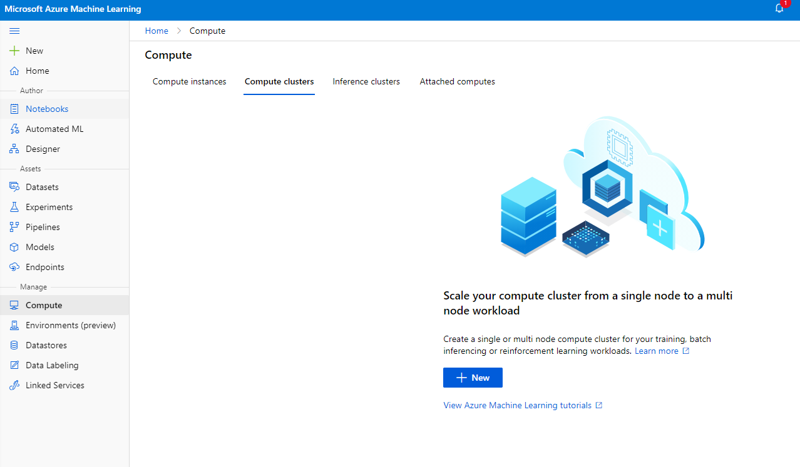

1. Elige tus opciones: Dedicado vs Baja prioridad, CPU o GPU, tamaño de la VM y número de núcleos (puedes mantener la configuración predeterminada para este proyecto).
2. Haz clic en el botón "Next".

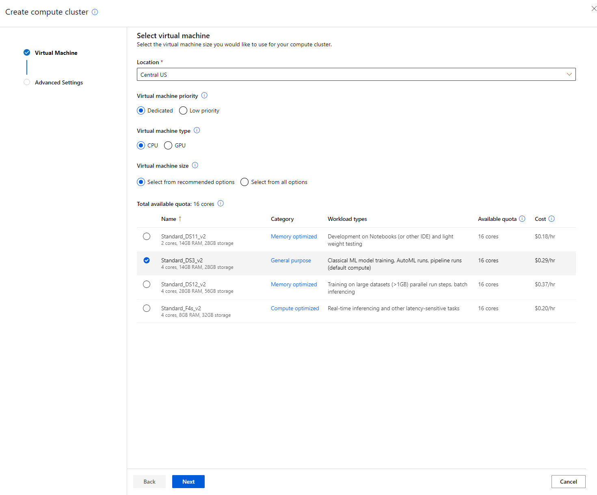

3. Dale un nombre al clúster de cómputo.  
4. Elige tus opciones: Número mínimo/máximo de nodos, segundos de inactividad antes de reducir el tamaño, acceso SSH. Ten en cuenta que si el número mínimo de nodos es 0, ahorrarás dinero cuando el clúster esté inactivo. Ten en cuenta que mientras mayor sea el número de nodos máximos, más corto será el entrenamiento. El número máximo de nodos recomendado es 3.  
5. Haz clic en el botón "Create". Este paso puede tardar unos minutos.

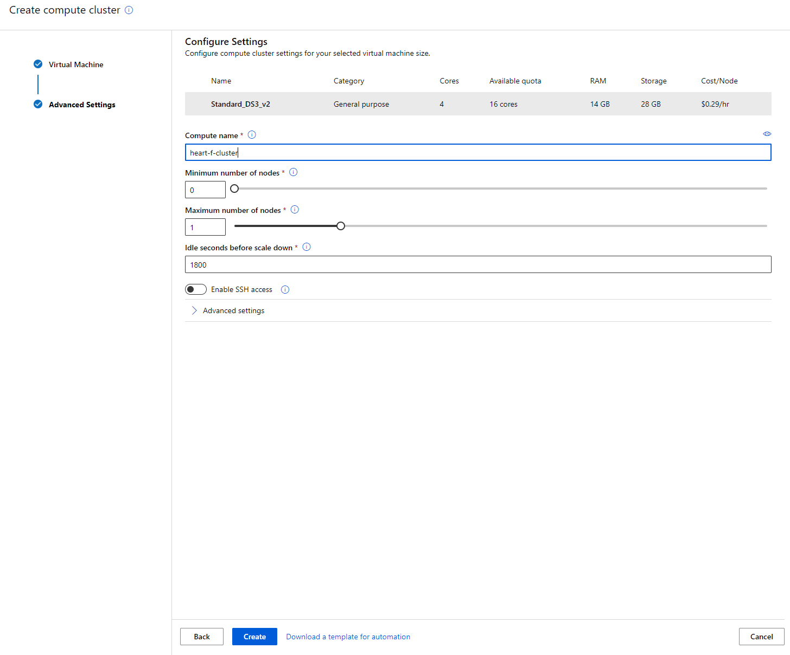

¡Genial! Ahora que tenemos un clúster de cómputo, necesitamos cargar los datos en Azure ML Studio.

### 2.3 Cargar el conjunto de datos

1. En el [espacio de trabajo de Azure ML](https://ml.azure.com/) que creamos anteriormente, haz clic en "Datasets" en el menú de la izquierda y haz clic en el botón "+ Create dataset" para crear un conjunto de datos. Elige la opción "From local files" y selecciona el conjunto de datos de Kaggle que descargamos anteriormente.

   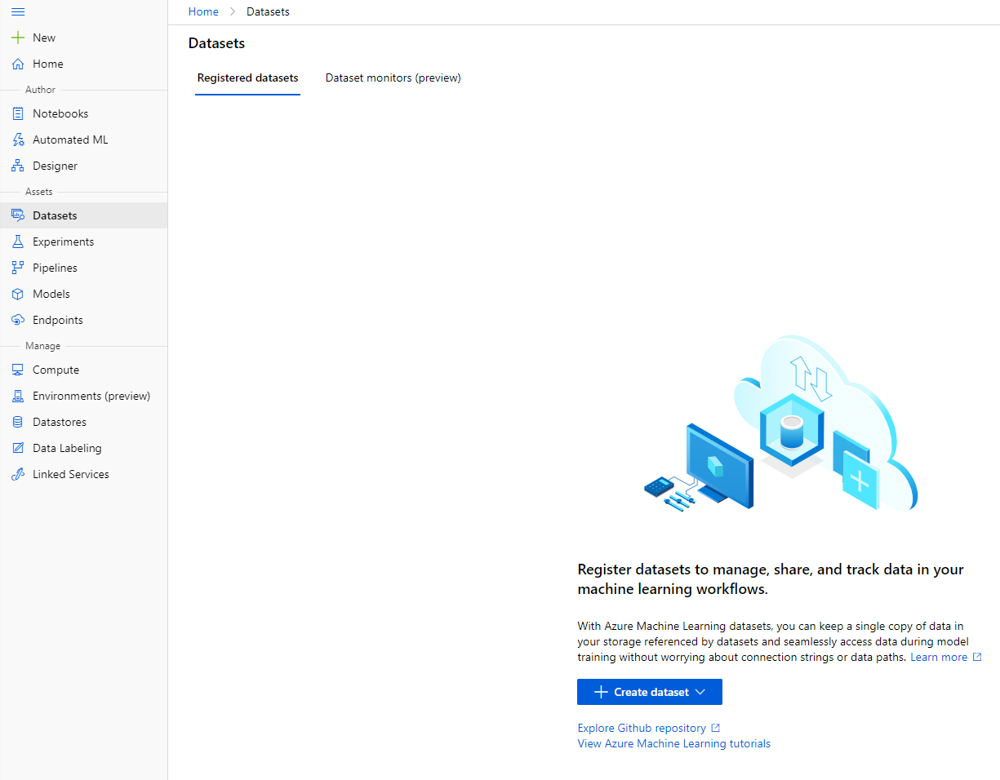

2. Dale un nombre, un tipo y una descripción a tu conjunto de datos. Haz clic en "Next". Sube los datos desde los archivos. Haz clic en "Next".

   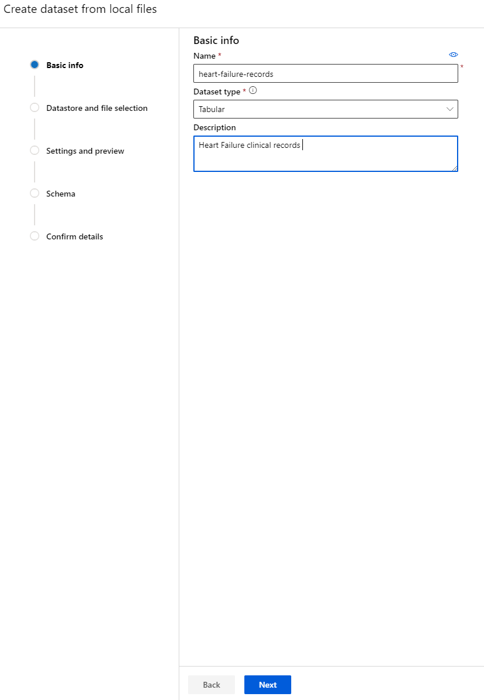

3. En el esquema, cambia el tipo de datos a Boolean para las siguientes características: anemia, diabetes, presión arterial alta, sexo, fumar y DEATH_EVENT. Haz clic en "Next" y luego en "Create".

   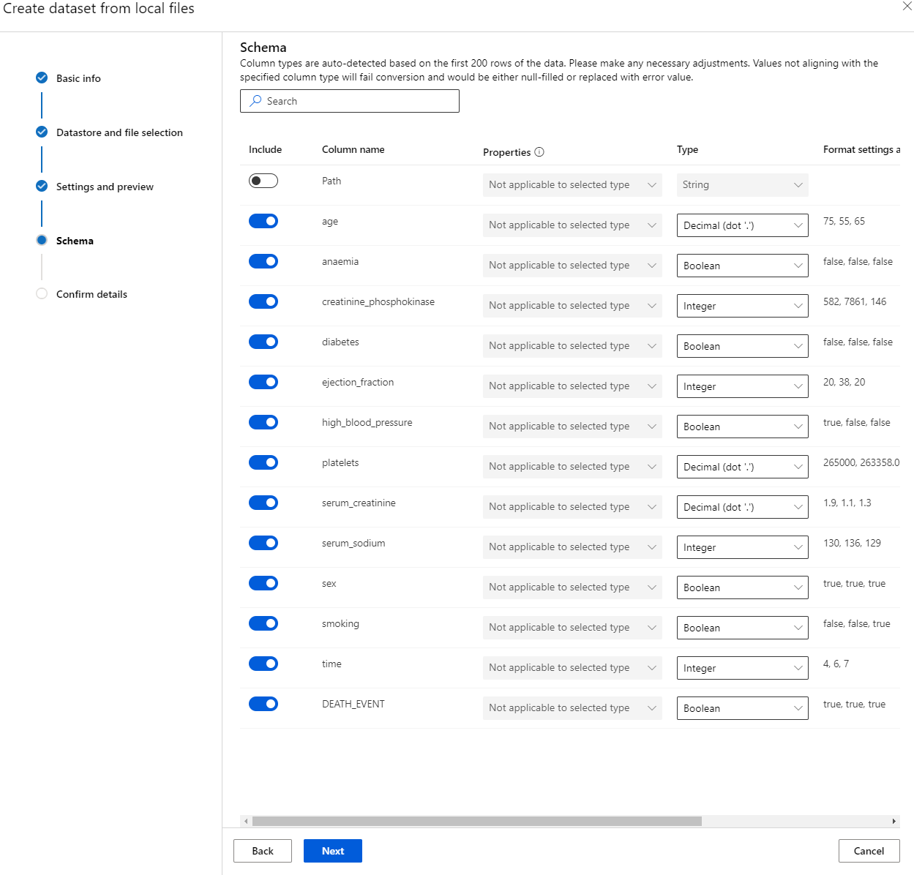

¡Perfecto! Ahora que el conjunto de datos está listo y el clúster de cómputo está creado, podemos comenzar el entrenamiento del modelo.

### 2.4 Entrenamiento con poco código/sin código usando AutoML

El desarrollo tradicional de modelos de aprendizaje automático consume muchos recursos, requiere un conocimiento significativo del dominio y tiempo para producir y comparar docenas de modelos.  
El aprendizaje automático automatizado (AutoML) es el proceso de automatizar las tareas iterativas y que consumen tiempo del desarrollo de modelos de aprendizaje automático. Permite a científicos de datos, analistas y desarrolladores construir modelos de ML con gran escala, eficiencia y productividad, manteniendo la calidad del modelo. Reduce el tiempo necesario para obtener modelos de ML listos para producción, con gran facilidad y eficiencia. [Más información](https://docs.microsoft.com/azure/machine-learning/concept-automated-ml?WT.mc_id=academic-77958-bethanycheum&ocid=AID3041109)

1. En el [espacio de trabajo de Azure ML](https://ml.azure.com/) que creamos anteriormente, haz clic en "Automated ML" en el menú de la izquierda y selecciona el conjunto de datos que acabas de subir. Haz clic en "Next".

   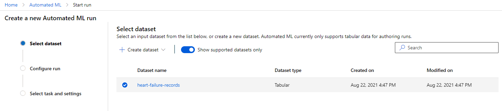

2. Ingresa un nuevo nombre de experimento, la columna objetivo (DEATH_EVENT) y el clúster de cómputo que creamos. Haz clic en "Next".

   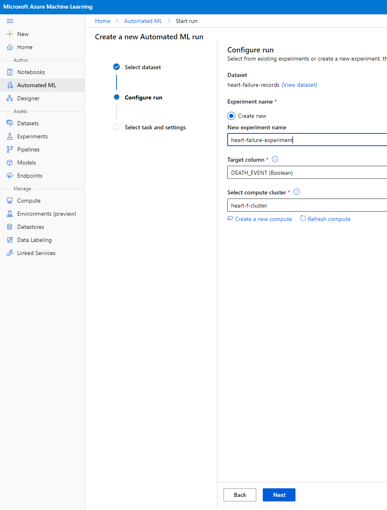

3. Elige "Classification" y haz clic en "Finish". Este paso puede tardar entre 30 minutos y 1 hora, dependiendo del tamaño de tu clúster de cómputo.

   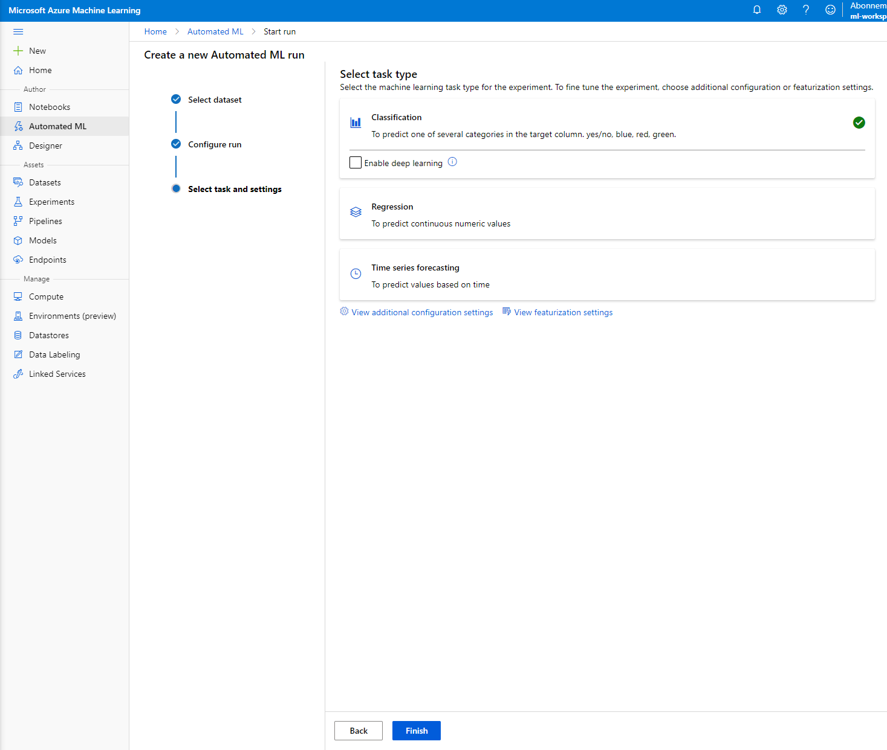

4. Una vez que la ejecución esté completa, haz clic en la pestaña "Automated ML", selecciona tu ejecución y haz clic en el algoritmo en la tarjeta "Best model summary".

   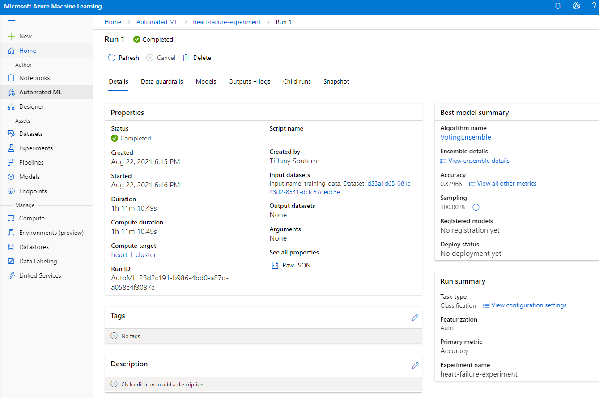

Aquí puedes ver una descripción detallada del mejor modelo que AutoML generó. También puedes explorar otros modelos generados en la pestaña "Models". Tómate unos minutos para explorar los modelos en el botón "Explanations (preview)". Una vez que hayas elegido el modelo que deseas usar (aquí elegiremos el mejor modelo seleccionado por AutoML), veremos cómo podemos desplegarlo.

## 3. Despliegue del modelo con poco código/sin código y consumo del endpoint
### 3.1 Despliegue del modelo

La interfaz de aprendizaje automático automatizado te permite desplegar el mejor modelo como un servicio web en unos pocos pasos. El despliegue es la integración del modelo para que pueda hacer predicciones basadas en nuevos datos e identificar áreas potenciales de oportunidad. Para este proyecto, el despliegue como un servicio web significa que las aplicaciones médicas podrán consumir el modelo para hacer predicciones en vivo sobre el riesgo de ataque cardíaco de sus pacientes.

En la descripción del mejor modelo, haz clic en el botón "Deploy".

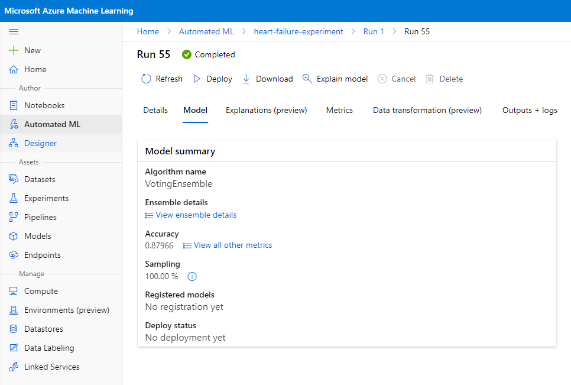

15. Dale un nombre, una descripción, tipo de cómputo (Azure Container Instance), habilita la autenticación y haz clic en "Deploy". Este paso puede tardar unos 20 minutos en completarse. El proceso de despliegue incluye varios pasos, como registrar el modelo, generar recursos y configurarlos para el servicio web. Aparece un mensaje de estado bajo "Deploy status". Selecciona "Refresh" periódicamente para verificar el estado del despliegue. Está desplegado y funcionando cuando el estado es "Healthy".

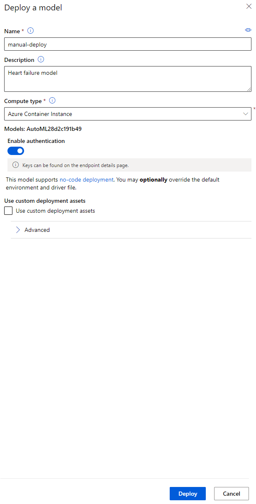

16. Una vez que se haya desplegado, haz clic en la pestaña "Endpoint" y selecciona el endpoint que acabas de desplegar. Aquí puedes encontrar todos los detalles que necesitas saber sobre el endpoint.

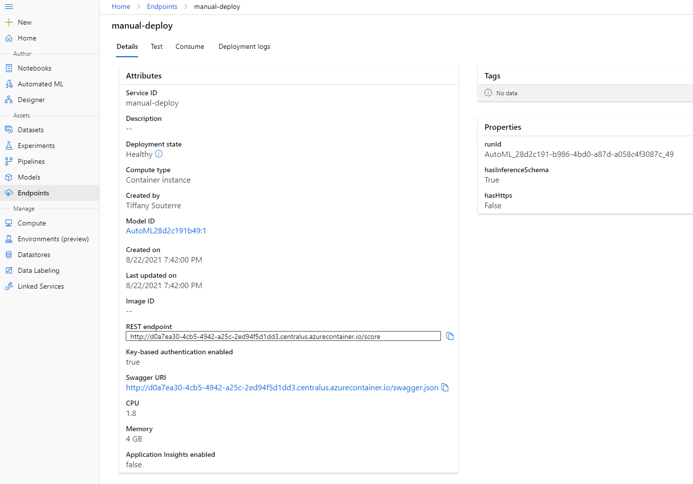

¡Increíble! Ahora que tenemos un modelo desplegado, podemos comenzar el consumo del endpoint.

### 3.2 Consumo del endpoint

Haz clic en la pestaña "Consume". Aquí puedes encontrar el endpoint REST y un script de Python en la opción de consumo. Tómate un tiempo para leer el código de Python.

Este script se puede ejecutar directamente desde tu máquina local y consumirá tu endpoint.

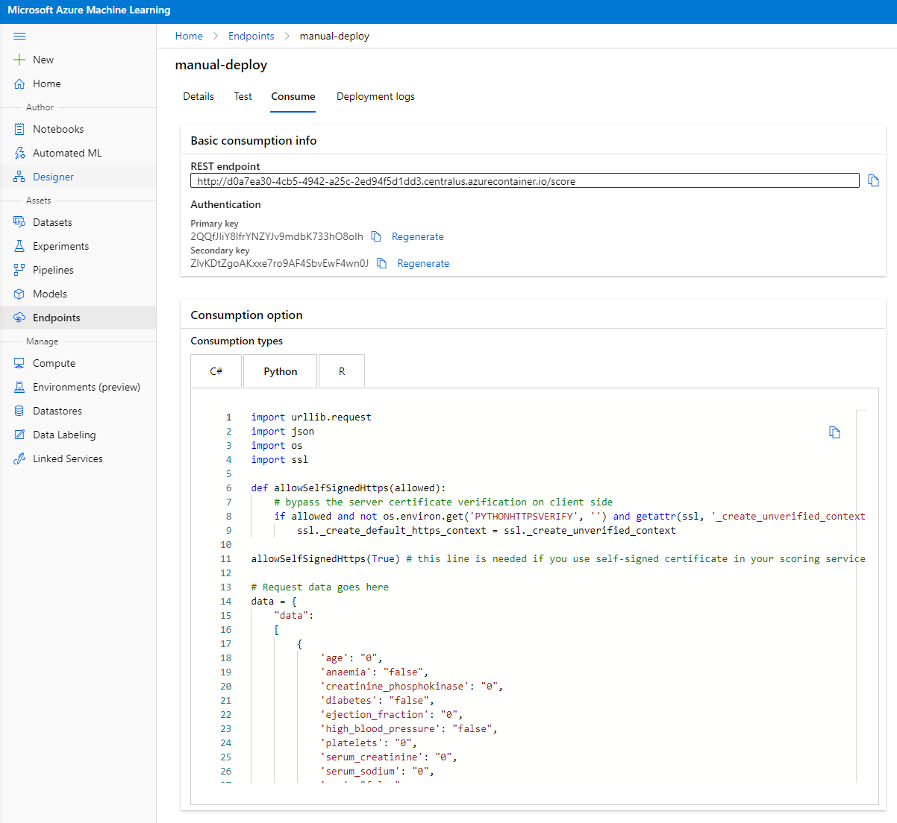

Tómate un momento para revisar estas dos líneas de código:

```python
url = 'http://98e3715f-xxxx-xxxx-xxxx-9ec22d57b796.centralus.azurecontainer.io/score'
api_key = '' # Replace this with the API key for the web service
```  
La variable `url` es el endpoint REST que se encuentra en la pestaña de consumo y la variable `api_key` es la clave primaria que también se encuentra en la pestaña de consumo (solo en caso de que hayas habilitado la autenticación). Así es como el script puede consumir el endpoint.

18. Al ejecutar el script, deberías ver el siguiente resultado:  
    ```python
    b'"{\\"result\\": [true]}"'
    ```  
Esto significa que la predicción de insuficiencia cardíaca para los datos proporcionados es verdadera. Esto tiene sentido porque si miras más de cerca los datos generados automáticamente en el script, todo está en 0 y falso por defecto. Puedes cambiar los datos con la siguiente muestra de entrada:

```python
data = {
    "data":
    [
        {
            'age': "0",
            'anaemia': "false",
            'creatinine_phosphokinase': "0",
            'diabetes': "false",
            'ejection_fraction': "0",
            'high_blood_pressure': "false",
            'platelets': "0",
            'serum_creatinine': "0",
            'serum_sodium': "0",
            'sex': "false",
            'smoking': "false",
            'time': "0",
        },
        {
            'age': "60",
            'anaemia': "false",
            'creatinine_phosphokinase': "500",
            'diabetes': "false",
            'ejection_fraction': "38",
            'high_blood_pressure': "false",
            'platelets': "260000",
            'serum_creatinine': "1.40",
            'serum_sodium': "137",
            'sex': "false",
            'smoking': "false",
            'time': "130",
        },
    ],
}
```  
El script debería devolver:  
    ```python
    b'"{\\"result\\": [true, false]}"'
    ```  

¡Felicidades! Acabas de consumir el modelo desplegado y lo entrenaste en Azure ML.

> **_NOTA:_** Una vez que hayas terminado con el proyecto, no olvides eliminar todos los recursos.

## 🚀 Desafío

Observa detenidamente las explicaciones del modelo y los detalles que AutoML generó para los mejores modelos. Trata de entender por qué el mejor modelo es mejor que los otros. ¿Qué algoritmos se compararon? ¿Cuáles son las diferencias entre ellos? ¿Por qué el mejor está funcionando mejor en este caso?

## [Cuestionario posterior a la lección](https://ff-quizzes.netlify.app/quiz/35?loc=es)

## Revisión y autoestudio

En esta lección, aprendiste cómo entrenar, desplegar y consumir un modelo para predecir el riesgo de insuficiencia cardíaca de manera sencilla en la nube. Si aún no lo has hecho, profundiza en las explicaciones del modelo que AutoML generó para los mejores modelos e intenta entender por qué el mejor modelo es mejor que los demás.

Puedes profundizar más en AutoML con poco código/sin código leyendo esta [documentación](https://docs.microsoft.com/azure/machine-learning/tutorial-first-experiment-automated-ml?WT.mc_id=academic-77958-bethanycheum&ocid=AID3041109).

## Tarea

[Proyecto de ciencia de datos con poco código/sin código en Azure ML](assignment.md)
