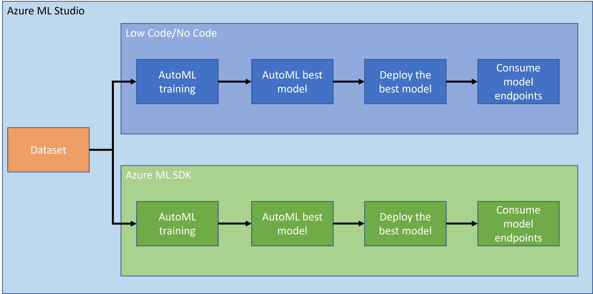
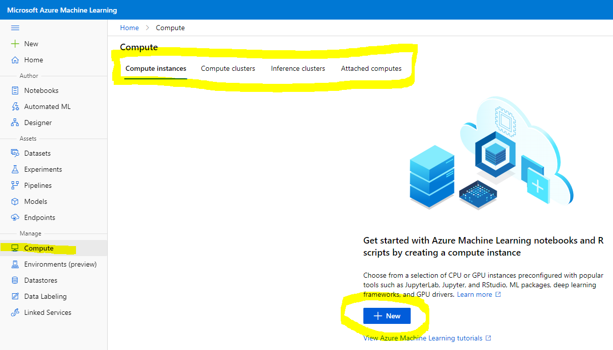
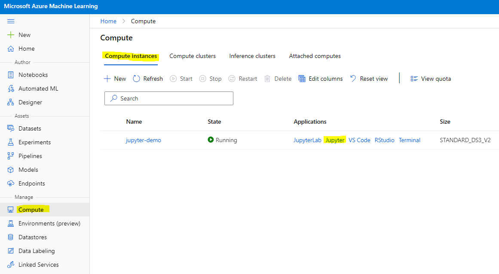
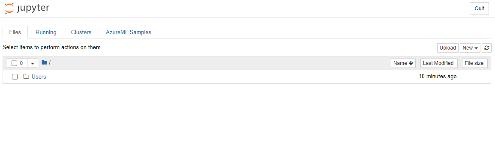

# Ciencia de Datos en la Nube: El camino del "Azure ML SDK"

| ](../../sketchnotes/19-DataScience-Cloud.png)|
|:---:|
| Ciencia de Datos en la Nube: Azure ML SDK - _Sketchnote por [@nitya](https://twitter.com/nitya)_ |

Tabla de contenidos:

- [Ciencia de Datos en la Nube: El camino del "Azure ML SDK"](../../5-Data-Science-In-Cloud/19-Azure)
  - [Cuestionario previo a la clase](../../5-Data-Science-In-Cloud/19-Azure)
  - [1. Introducción](../../5-Data-Science-In-Cloud/19-Azure)
    - [1.1 ¿Qué es Azure ML SDK?](../../5-Data-Science-In-Cloud/19-Azure)
    - [1.2 Introducción al proyecto de predicción de insuficiencia cardíaca y al conjunto de datos](../../5-Data-Science-In-Cloud/19-Azure)
  - [2. Entrenamiento de un modelo con Azure ML SDK](../../5-Data-Science-In-Cloud/19-Azure)
    - [2.1 Crear un espacio de trabajo de Azure ML](../../5-Data-Science-In-Cloud/19-Azure)
    - [2.2 Crear una instancia de cómputo](../../5-Data-Science-In-Cloud/19-Azure)
    - [2.3 Cargar el conjunto de datos](../../5-Data-Science-In-Cloud/19-Azure)
    - [2.4 Crear Notebooks](../../5-Data-Science-In-Cloud/19-Azure)
    - [2.5 Entrenar un modelo](../../5-Data-Science-In-Cloud/19-Azure)
      - [2.5.1 Configurar espacio de trabajo, experimento, clúster de cómputo y conjunto de datos](../../5-Data-Science-In-Cloud/19-Azure)
      - [2.5.2 Configuración de AutoML y entrenamiento](../../5-Data-Science-In-Cloud/19-Azure)
  - [3. Despliegue del modelo y consumo del endpoint con Azure ML SDK](../../5-Data-Science-In-Cloud/19-Azure)
    - [3.1 Guardar el mejor modelo](../../5-Data-Science-In-Cloud/19-Azure)
    - [3.2 Despliegue del modelo](../../5-Data-Science-In-Cloud/19-Azure)
    - [3.3 Consumo del endpoint](../../5-Data-Science-In-Cloud/19-Azure)
  - [🚀 Desafío](../../5-Data-Science-In-Cloud/19-Azure)
  - [Cuestionario posterior a la clase](../../5-Data-Science-In-Cloud/19-Azure)
  - [Revisión y autoestudio](../../5-Data-Science-In-Cloud/19-Azure)
  - [Tarea](../../5-Data-Science-In-Cloud/19-Azure)

## [Cuestionario previo a la clase](https://ff-quizzes.netlify.app/quiz/36?loc=es)

## 1. Introducción

### 1.1 ¿Qué es Azure ML SDK?

Los científicos de datos y desarrolladores de IA utilizan el SDK de Azure Machine Learning para construir y ejecutar flujos de trabajo de aprendizaje automático con el servicio de Azure Machine Learning. Puedes interactuar con el servicio en cualquier entorno de Python, incluidos Jupyter Notebooks, Visual Studio Code o tu IDE de Python favorito.

Áreas clave del SDK incluyen:

- Explorar, preparar y gestionar el ciclo de vida de tus conjuntos de datos utilizados en experimentos de aprendizaje automático.
- Administrar recursos en la nube para monitoreo, registro y organización de tus experimentos de aprendizaje automático.
- Entrenar modelos localmente o utilizando recursos en la nube, incluyendo entrenamiento acelerado por GPU.
- Usar aprendizaje automático automatizado, que acepta parámetros de configuración y datos de entrenamiento. Itera automáticamente a través de algoritmos y configuraciones de hiperparámetros para encontrar el mejor modelo para realizar predicciones.
- Desplegar servicios web para convertir tus modelos entrenados en servicios RESTful que pueden ser consumidos en cualquier aplicación.

[Aprende más sobre el SDK de Azure Machine Learning](https://docs.microsoft.com/python/api/overview/azure/ml?WT.mc_id=academic-77958-bethanycheum&ocid=AID3041109)

En la [lección anterior](../18-Low-Code/README.md), vimos cómo entrenar, desplegar y consumir un modelo de manera Low code/No code. Utilizamos el conjunto de datos de insuficiencia cardíaca para generar un modelo de predicción de insuficiencia cardíaca. En esta lección, vamos a hacer exactamente lo mismo pero utilizando el SDK de Azure Machine Learning.



### 1.2 Introducción al proyecto de predicción de insuficiencia cardíaca y al conjunto de datos

Consulta [aquí](../18-Low-Code/README.md) la introducción al proyecto de predicción de insuficiencia cardíaca y al conjunto de datos.

## 2. Entrenamiento de un modelo con Azure ML SDK
### 2.1 Crear un espacio de trabajo de Azure ML

Para simplificar, vamos a trabajar en un notebook de Jupyter. Esto implica que ya tienes un espacio de trabajo y una instancia de cómputo. Si ya tienes un espacio de trabajo, puedes saltar directamente a la sección 2.3 Creación de Notebook.

Si no, sigue las instrucciones en la sección **2.1 Crear un espacio de trabajo de Azure ML** en la [lección anterior](../18-Low-Code/README.md) para crear un espacio de trabajo.

### 2.2 Crear una instancia de cómputo

En el [espacio de trabajo de Azure ML](https://ml.azure.com/) que creamos anteriormente, ve al menú de cómputo y verás los diferentes recursos de cómputo disponibles.



Vamos a crear una instancia de cómputo para provisionar un notebook de Jupyter. 
1. Haz clic en el botón + Nuevo. 
2. Asigna un nombre a tu instancia de cómputo.
3. Elige tus opciones: CPU o GPU, tamaño de la VM y número de núcleos.
4. Haz clic en el botón Crear.

¡Felicidades, acabas de crear una instancia de cómputo! Usaremos esta instancia de cómputo para crear un Notebook en la sección [Creación de Notebooks](../../5-Data-Science-In-Cloud/19-Azure).

### 2.3 Cargar el conjunto de datos
Consulta la [lección anterior](../18-Low-Code/README.md) en la sección **2.3 Cargar el conjunto de datos** si aún no has subido el conjunto de datos.

### 2.4 Crear Notebooks

> **_NOTA:_** Para el siguiente paso puedes crear un nuevo notebook desde cero, o puedes subir el [notebook que creamos](../../5-Data-Science-In-Cloud/19-Azure/notebook.ipynb) en tu Azure ML Studio. Para subirlo, simplemente haz clic en el menú "Notebook" y sube el notebook.

Los notebooks son una parte realmente importante del proceso de ciencia de datos. Pueden ser utilizados para realizar análisis exploratorio de datos (EDA), llamar a un clúster de cómputo para entrenar un modelo, o llamar a un clúster de inferencia para desplegar un endpoint. 

Para crear un Notebook, necesitamos un nodo de cómputo que esté sirviendo la instancia de notebook de Jupyter. Regresa al [espacio de trabajo de Azure ML](https://ml.azure.com/) y haz clic en Instancias de cómputo. En la lista de instancias de cómputo deberías ver la [instancia de cómputo que creamos anteriormente](../../5-Data-Science-In-Cloud/19-Azure). 

1. En la sección de Aplicaciones, haz clic en la opción Jupyter. 
2. Marca la casilla "Sí, entiendo" y haz clic en el botón Continuar.

3. Esto debería abrir una nueva pestaña del navegador con tu instancia de notebook de Jupyter como se muestra. Haz clic en el botón "Nuevo" para crear un notebook.



Ahora que tenemos un Notebook, podemos comenzar a entrenar el modelo con Azure ML SDK.

### 2.5 Entrenar un modelo

Primero que nada, si alguna vez tienes dudas, consulta la [documentación del SDK de Azure ML](https://docs.microsoft.com/python/api/overview/azure/ml?WT.mc_id=academic-77958-bethanycheum&ocid=AID3041109). Contiene toda la información necesaria para entender los módulos que vamos a ver en esta lección.

#### 2.5.1 Configurar espacio de trabajo, experimento, clúster de cómputo y conjunto de datos

Necesitas cargar el `workspace` desde el archivo de configuración utilizando el siguiente código:

```python
from azureml.core import Workspace
ws = Workspace.from_config()
```

Esto devuelve un objeto de tipo `Workspace` que representa el espacio de trabajo. Luego necesitas crear un `experiment` utilizando el siguiente código:

```python
from azureml.core import Experiment
experiment_name = 'aml-experiment'
experiment = Experiment(ws, experiment_name)
```
Para obtener o crear un experimento desde un espacio de trabajo, solicitas el experimento utilizando el nombre del experimento. El nombre del experimento debe tener entre 3 y 36 caracteres, comenzar con una letra o un número, y solo puede contener letras, números, guiones bajos y guiones. Si el experimento no se encuentra en el espacio de trabajo, se crea un nuevo experimento.

Ahora necesitas crear un clúster de cómputo para el entrenamiento utilizando el siguiente código. Ten en cuenta que este paso puede tardar unos minutos. 

```python
from azureml.core.compute import AmlCompute

aml_name = "heart-f-cluster"
try:
    aml_compute = AmlCompute(ws, aml_name)
    print('Found existing AML compute context.')
except:
    print('Creating new AML compute context.')
    aml_config = AmlCompute.provisioning_configuration(vm_size = "Standard_D2_v2", min_nodes=1, max_nodes=3)
    aml_compute = AmlCompute.create(ws, name = aml_name, provisioning_configuration = aml_config)
    aml_compute.wait_for_completion(show_output = True)

cts = ws.compute_targets
compute_target = cts[aml_name]
```

Puedes obtener el conjunto de datos desde el espacio de trabajo utilizando el nombre del conjunto de datos de la siguiente manera:

```python
dataset = ws.datasets['heart-failure-records']
df = dataset.to_pandas_dataframe()
df.describe()
```
#### 2.5.2 Configuración de AutoML y entrenamiento

Para configurar AutoML, utiliza la clase [AutoMLConfig](https://docs.microsoft.com/python/api/azureml-train-automl-client/azureml.train.automl.automlconfig(class)?WT.mc_id=academic-77958-bethanycheum&ocid=AID3041109).

Como se describe en la documentación, hay muchos parámetros con los que puedes jugar. Para este proyecto, utilizaremos los siguientes parámetros:

- `experiment_timeout_minutes`: El tiempo máximo (en minutos) que se permite que el experimento se ejecute antes de que se detenga automáticamente y los resultados se hagan disponibles automáticamente.
- `max_concurrent_iterations`: El número máximo de iteraciones de entrenamiento concurrentes permitidas para el experimento.
- `primary_metric`: La métrica principal utilizada para determinar el estado del experimento.
- `compute_target`: El objetivo de cómputo de Azure Machine Learning para ejecutar el experimento de aprendizaje automático automatizado.
- `task`: El tipo de tarea a ejecutar. Los valores pueden ser 'classification', 'regression' o 'forecasting' dependiendo del tipo de problema de aprendizaje automático automatizado a resolver.
- `training_data`: Los datos de entrenamiento que se utilizarán dentro del experimento. Debe contener tanto características de entrenamiento como una columna de etiquetas (opcionalmente una columna de pesos de muestra).
- `label_column_name`: El nombre de la columna de etiquetas.
- `path`: La ruta completa a la carpeta del proyecto de Azure Machine Learning.
- `enable_early_stopping`: Si se habilita la terminación anticipada si la puntuación no mejora a corto plazo.
- `featurization`: Indicador de si el paso de featurización debe realizarse automáticamente o no, o si se debe utilizar una featurización personalizada.
- `debug_log`: El archivo de registro para escribir información de depuración.

```python
from azureml.train.automl import AutoMLConfig

project_folder = './aml-project'

automl_settings = {
    "experiment_timeout_minutes": 20,
    "max_concurrent_iterations": 3,
    "primary_metric" : 'AUC_weighted'
}

automl_config = AutoMLConfig(compute_target=compute_target,
                             task = "classification",
                             training_data=dataset,
                             label_column_name="DEATH_EVENT",
                             path = project_folder,  
                             enable_early_stopping= True,
                             featurization= 'auto',
                             debug_log = "automl_errors.log",
                             **automl_settings
                            )
```
Ahora que tienes tu configuración lista, puedes entrenar el modelo utilizando el siguiente código. Este paso puede tardar hasta una hora dependiendo del tamaño de tu clúster.

```python
remote_run = experiment.submit(automl_config)
```
Puedes ejecutar el widget RunDetails para mostrar los diferentes experimentos.
```python
from azureml.widgets import RunDetails
RunDetails(remote_run).show()
```
## 3. Despliegue del modelo y consumo del endpoint con Azure ML SDK

### 3.1 Guardar el mejor modelo

El `remote_run` es un objeto de tipo [AutoMLRun](https://docs.microsoft.com/python/api/azureml-train-automl-client/azureml.train.automl.run.automlrun?WT.mc_id=academic-77958-bethanycheum&ocid=AID3041109). Este objeto contiene el método `get_output()` que devuelve la mejor ejecución y el modelo ajustado correspondiente.

```python
best_run, fitted_model = remote_run.get_output()
```
Puedes ver los parámetros utilizados para el mejor modelo simplemente imprimiendo el `fitted_model` y ver las propiedades del mejor modelo utilizando el método [get_properties()](https://docs.microsoft.com/python/api/azureml-core/azureml.core.run(class)?view=azure-ml-py#azureml_core_Run_get_properties?WT.mc_id=academic-77958-bethanycheum&ocid=AID3041109).

```python
best_run.get_properties()
```

Ahora registra el modelo con el método [register_model](https://docs.microsoft.com/python/api/azureml-train-automl-client/azureml.train.automl.run.automlrun?view=azure-ml-py#register-model-model-name-none--description-none--tags-none--iteration-none--metric-none-?WT.mc_id=academic-77958-bethanycheum&ocid=AID3041109).
```python
model_name = best_run.properties['model_name']
script_file_name = 'inference/score.py'
best_run.download_file('outputs/scoring_file_v_1_0_0.py', 'inference/score.py')
description = "aml heart failure project sdk"
model = best_run.register_model(model_name = model_name,
                                model_path = './outputs/',
                                description = description,
                                tags = None)
```
### 3.2 Despliegue del modelo

Una vez que el mejor modelo está guardado, podemos desplegarlo con la clase [InferenceConfig](https://docs.microsoft.com/python/api/azureml-core/azureml.core.model.inferenceconfig?view=azure-ml-py?ocid=AID3041109). InferenceConfig representa la configuración para un entorno personalizado utilizado para el despliegue. La clase [AciWebservice](https://docs.microsoft.com/python/api/azureml-core/azureml.core.webservice.aciwebservice?view=azure-ml-py) representa un modelo de aprendizaje automático desplegado como un endpoint de servicio web en Azure Container Instances. Un servicio web desplegado se crea a partir de un modelo, script y archivos asociados. El servicio web resultante es un endpoint HTTP balanceado con una API REST. Puedes enviar datos a esta API y recibir la predicción devuelta por el modelo.

El modelo se despliega utilizando el método [deploy](https://docs.microsoft.com/python/api/azureml-core/azureml.core.model(class)?view=azure-ml-py#deploy-workspace--name--models--inference-config-none--deployment-config-none--deployment-target-none--overwrite-false--show-output-false-?WT.mc_id=academic-77958-bethanycheum&ocid=AID3041109).

```python
from azureml.core.model import InferenceConfig, Model
from azureml.core.webservice import AciWebservice

inference_config = InferenceConfig(entry_script=script_file_name, environment=best_run.get_environment())

aciconfig = AciWebservice.deploy_configuration(cpu_cores = 1,
                                               memory_gb = 1,
                                               tags = {'type': "automl-heart-failure-prediction"},
                                               description = 'Sample service for AutoML Heart Failure Prediction')

aci_service_name = 'automl-hf-sdk'
aci_service = Model.deploy(ws, aci_service_name, [model], inference_config, aciconfig)
aci_service.wait_for_deployment(True)
print(aci_service.state)
```
Este paso debería tardar unos minutos.

### 3.3 Consumo del endpoint

Puedes consumir tu endpoint creando una entrada de muestra:

```python
data = {
    "data":
    [
        {
            'age': "60",
            'anaemia': "false",
            'creatinine_phosphokinase': "500",
            'diabetes': "false",
            'ejection_fraction': "38",
            'high_blood_pressure': "false",
            'platelets': "260000",
            'serum_creatinine': "1.40",
            'serum_sodium': "137",
            'sex': "false",
            'smoking': "false",
            'time': "130",
        },
    ],
}

test_sample = str.encode(json.dumps(data))
```
Y luego puedes enviar esta entrada a tu modelo para obtener una predicción:
```python
response = aci_service.run(input_data=test_sample)
response
```  
Esto debería generar `'{"result": [false]}'`. Esto significa que la entrada del paciente que enviamos al endpoint generó la predicción `false`, lo que indica que esta persona no es propensa a sufrir un ataque al corazón.

¡Felicidades! Acabas de consumir el modelo desplegado y entrenado en Azure ML con el Azure ML SDK.

> **_NOTA:_** Una vez que termines el proyecto, no olvides eliminar todos los recursos.

## 🚀 Desafío

Hay muchas otras cosas que puedes hacer a través del SDK; desafortunadamente, no podemos verlas todas en esta lección. Pero buenas noticias: aprender a explorar la documentación del SDK puede llevarte muy lejos por tu cuenta. Echa un vistazo a la documentación del Azure ML SDK y encuentra la clase `Pipeline`, que te permite crear pipelines. Un Pipeline es una colección de pasos que pueden ejecutarse como un flujo de trabajo.

**PISTA:** Ve a la [documentación del SDK](https://docs.microsoft.com/python/api/overview/azure/ml/?view=azure-ml-py?WT.mc_id=academic-77958-bethanycheum&ocid=AID3041109) y escribe palabras clave como "Pipeline" en la barra de búsqueda. Deberías encontrar la clase `azureml.pipeline.core.Pipeline` en los resultados de búsqueda.

## [Cuestionario posterior a la lección](https://ff-quizzes.netlify.app/quiz/37?loc=es)

## Revisión y Autoestudio

En esta lección, aprendiste a entrenar, desplegar y consumir un modelo para predecir el riesgo de insuficiencia cardíaca con el Azure ML SDK en la nube. Consulta esta [documentación](https://docs.microsoft.com/python/api/overview/azure/ml/?view=azure-ml-py?WT.mc_id=academic-77958-bethanycheum&ocid=AID3041109) para obtener más información sobre el Azure ML SDK. Intenta crear tu propio modelo con el Azure ML SDK.

## Tarea

[Proyecto de Ciencia de Datos usando Azure ML SDK](assignment.md)
