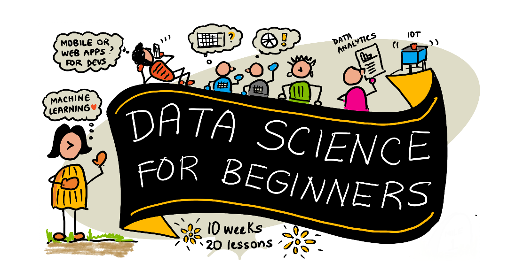
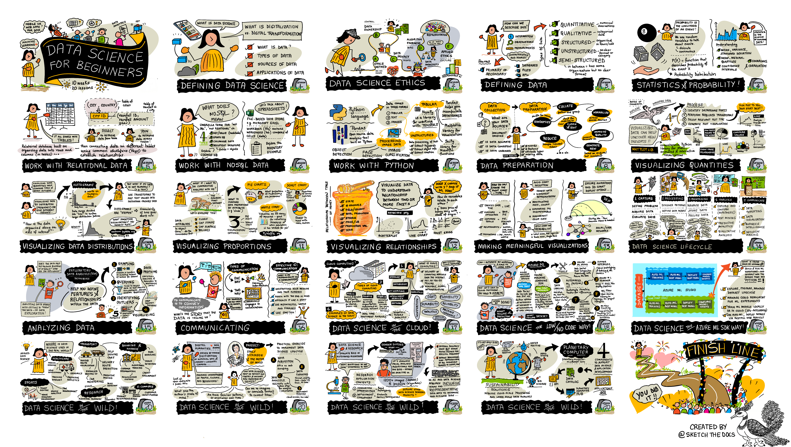

# Ciencia de Datos para Principiantes — Un Currículo de 10 Semanas y 20 Lecciones

[](LICENSE)
[](https://www.python.org/)
[](https://jupyter.org/)
[](https://code.visualstudio.com/)
[](https://github.com/codespaces)

Bienvenido al repositorio en **español latino** del plan de estudios **Ciencia de Datos para Principiantes** (*Data Science for Beginners*), adaptado y estructurado con rigor pedagógico universitario a partir del prestigioso currículo de Microsoft.

Este curso está concebido para guiarte paso a paso, desde los conceptos fundamentales y matemáticos hasta la construcción de modelos, visualización analítica avanzada y despliegue de soluciones en la nube, combinando teoría sólida, código interactivo en Python y proyectos prácticos del mundo real.

|  |
| :--------------------------------------------------------: |
| _Ciencia de Datos para Principiantes — Sketchnote por [@nitya](https://twitter.com/nitya)_ |

---

## 🧭 Filosofía Pedagógica y Terminología

Como docentes de ciencia de datos, nuestro compromiso es brindarte una formación que refleje fielmente los estándares de la industria tecnológica y la investigación académica contemporánea:

1. **Aprender construyendo (*Project-Based Learning*)**: Cada lección incluye ejercicios de código en vivo y tareas aplicadas con rúbricas de evaluación claras.
2. **Evaluación continua y formativa**: Cada lección cuenta con un **cuestionario previo** (*pre-lecture quiz*) para activar tus conocimientos previos y un **cuestionario posterior** (*post-lecture quiz*) para consolidar lo aprendido.
3. **Preservación de la terminología nativa de Ciencia de Datos**: En el ejercicio profesional de la Ciencia de Datos y el Machine Learning en Latinoamérica y a nivel internacional, los términos clave se emplean habitualmente en su idioma original en inglés. Por ello, en este currículo mantenemos términos técnicos estándar como *DataFrame*, *Feature Engineering*, *Overfitting*, *EDA*, *Pipeline*, *Clustering*, *Bias-Variance Tradeoff* o *Random Forest*, acompañados siempre de su fundamentación y explicación conceptual en español. El código fuente en Python, los nombres de variables, funciones y librerías se preservan rigurosamente intactos para garantizar su correcta ejecución técnica.

---

## 🗺️ Hoja de Ruta del Aprendizaje (Roadmap)

|  |
| :--------------------------------------------------: |
| _Hoja de ruta del curso de 10 semanas — Sketchnote por [@nitya](https://twitter.com/nitya)_ |

---

## 📚 Plan de Estudios (Syllabus de 10 Semanas)

| Semana | Módulo | Lección | Conceptos Clave | Notebook / Código | Tarea / Proyecto | Cuestionarios |
|:---:|:---|:---|:---|:---:|:---:|:---:|
| **Semana 1** | **1. Introducción** | **01.** [Definiendo la Ciencia de Datos](1-Introduction/01-defining-data-science/README.md) | ¿Qué es la ciencia de datos?, métodos científicos, datos estructurados vs no estructurados, dominios de aplicación. | [`notebook.ipynb`](1-Introduction/01-defining-data-science/notebook.ipynb) | [`assignment.md`](1-Introduction/01-defining-data-science/assignment.md) | [Previo](https://ff-quizzes.netlify.app/quiz/0?loc=es) / [Posterior](https://ff-quizzes.netlify.app/quiz/1?loc=es) |
| | | **02.** [Ética en Ciencia de Datos](1-Introduction/02-ethics/README.md) | Privacidad, sesgo algorítmico (*bias*), equidad, transparencia y responsabilidad en la toma de decisiones con datos. | — | [`assignment.md`](1-Introduction/02-ethics/assignment.md) | [Previo](https://ff-quizzes.netlify.app/quiz/2?loc=es) / [Posterior](https://ff-quizzes.netlify.app/quiz/3?loc=es) |
| **Semana 2** | **1. Introducción** | **03.** [Definiendo los Datos](1-Introduction/03-defining-data/README.md) | Tipos de datos (cualitativos, cuantitativos, continuos, discretos), fuentes primarias, secundarias y APIs. | — | [`assignment.md`](1-Introduction/03-defining-data/assignment.md) | [Previo](https://ff-quizzes.netlify.app/quiz/4?loc=es) / [Posterior](https://ff-quizzes.netlify.app/quiz/5?loc=es) |
| | | **04.** [Estadística y Probabilidad](1-Introduction/04-stats-and-probability/README.md) | Medidas de tendencia central y dispersión, distribuciones teóricas, prueba de hipótesis (*t-test*), Teorema del Límite Central. | [`notebook.ipynb`](1-Introduction/04-stats-and-probability/notebook.ipynb) | [`assignment.ipynb`](1-Introduction/04-stats-and-probability/assignment.ipynb) | [Previo](https://ff-quizzes.netlify.app/quiz/6?loc=es) / [Posterior](https://ff-quizzes.netlify.app/quiz/7?loc=es) |
| **Semana 3** | **2. Trabajando con Datos** | **05.** [Bases de Datos Relacionales](2-Working-With-Data/05-relational-databases/README.md) | Modelo relacional, SQL, DDL, DML, operaciones de unión (*JOIN*), normalización e índices. | — | [`assignment.md`](2-Working-With-Data/05-relational-databases/assignment.md) | [Previo](https://ff-quizzes.netlify.app/quiz/8?loc=es) / [Posterior](https://ff-quizzes.netlify.app/quiz/9?loc=es) |
| | | **06.** [Bases de Datos No Relacionales](2-Working-With-Data/06-non-relational/README.md) | Almacenamiento NoSQL: documentos (JSON), pares clave-valor, almacenes en columnas, grafos. | — | [`assignment.md`](2-Working-With-Data/06-non-relational/assignment.md) | [Previo](https://ff-quizzes.netlify.app/quiz/10?loc=es) / [Posterior](https://ff-quizzes.netlify.app/quiz/11?loc=es) |
| **Semana 4** | **2. Trabajando con Datos** | **07.** [Python para Ciencia de Datos](2-Working-With-Data/07-python/README.md) | Ecosistema Python, NumPy arrays, Pandas DataFrames, indexación, filtrado y agregación. | [`notebook.ipynb`](2-Working-With-Data/07-python/notebook.ipynb) | [`assignment.md`](2-Working-With-Data/07-python/assignment.md) | [Previo](https://ff-quizzes.netlify.app/quiz/12?loc=es) / [Posterior](https://ff-quizzes.netlify.app/quiz/13?loc=es) |
| | | **08.** [Preparación de Datos (Data Wrangling)](2-Working-With-Data/08-data-preparation/README.md) | Limpieza de datos, imputación de valores nulos, detección de *outliers*, normalización y codificación categórica (*One-Hot Encoding*). | [`notebook.ipynb`](2-Working-With-Data/08-data-preparation/notebook.ipynb) | [`assignment.ipynb`](2-Working-With-Data/08-data-preparation/assignment.ipynb) | [Previo](https://ff-quizzes.netlify.app/quiz/14?loc=es) / [Posterior](https://ff-quizzes.netlify.app/quiz/15?loc=es) |
| **Semana 5** | **3. Visualización** | **09.** [Visualización de Cantidades](3-Data-Visualization/09-visualization-quantities/README.md) | Gráficos de barras, barras apiladas, líneas y gráficos de dispersión con Matplotlib y Seaborn. | [`notebook.ipynb`](3-Data-Visualization/09-visualization-quantities/notebook.ipynb) | [`assignment.md`](3-Data-Visualization/09-visualization-quantities/assignment.md) | [Previo](https://ff-quizzes.netlify.app/quiz/16?loc=es) / [Posterior](https://ff-quizzes.netlify.app/quiz/17?loc=es) |
| | | **10.** [Visualización de Distribuciones](3-Data-Visualization/10-visualization-distributions/README.md) | Histogramas, gráficos de densidad kernel (KDE), diagramas de caja y bigotes (*box plots*). | [`notebook.ipynb`](3-Data-Visualization/10-visualization-distributions/notebook.ipynb) | [`assignment.md`](3-Data-Visualization/10-visualization-distributions/assignment.md) | [Previo](https://ff-quizzes.netlify.app/quiz/18?loc=es) / [Posterior](https://ff-quizzes.netlify.app/quiz/19?loc=es) |
| **Semana 6** | **3. Visualización** | **11.** [Visualización de Proporciones](3-Data-Visualization/11-visualization-proportions/README.md) | Gráficos de dona, gráficos circulares (*pie charts*), diagramas de árbol (*treemaps*) y buenas prácticas perceptivas. | [`notebook.ipynb`](3-Data-Visualization/11-visualization-proportions/notebook.ipynb) | [`assignment.md`](3-Data-Visualization/11-visualization-proportions/assignment.md) | [Previo](https://ff-quizzes.netlify.app/quiz/20?loc=es) / [Posterior](https://ff-quizzes.netlify.app/quiz/21?loc=es) |
| | | **12.** [Visualización de Relaciones](3-Data-Visualization/12-visualization-relationships/README.md) | Matrices de correlación, mapas de calor (*heatmaps*), diagramas de dispersión multivariados y líneas de tendencia. | [`notebook.ipynb`](3-Data-Visualization/12-visualization-relationships/notebook.ipynb) | [`assignment.md`](3-Data-Visualization/12-visualization-relationships/assignment.md) | [Previo](https://ff-quizzes.netlify.app/quiz/22?loc=es) / [Posterior](https://ff-quizzes.netlify.app/quiz/23?loc=es) |
| **Semana 7** | **3. Visualización** | **13.** [Visualizaciones Significativas](3-Data-Visualization/13-meaningful-visualizations/README.md) | Narrativa de datos (*Data Storytelling*), diseño centrado en el usuario, accesibilidad (daltonismo) e interactividad web. | [`correlation-analysis.ipynb`](3-Data-Visualization/13-meaningful-visualizations/correlation-analysis.ipynb) | [`assignment.md`](3-Data-Visualization/13-meaningful-visualizations/assignment.md) | [Previo](https://ff-quizzes.netlify.app/quiz/24?loc=es) / [Posterior](https://ff-quizzes.netlify.app/quiz/25?loc=es) |
| **Semana 8** | **4. Ciclo de Vida** | **14.** [Introducción al Ciclo de Vida](4-Data-Science-Lifecycle/14-Introduction/README.md) | Metodologías estándar en la industria (CRISP-DM, OSEMN, TDSP), definición del problema y recopilación de requerimientos. | [`notebook.ipynb`](4-Data-Science-Lifecycle/14-Introduction/notebook.ipynb) | [`assignment.md`](4-Data-Science-Lifecycle/14-Introduction/assignment.md) | [Previo](https://ff-quizzes.netlify.app/quiz/26?loc=es) / [Posterior](https://ff-quizzes.netlify.app/quiz/27?loc=es) |
| | | **15.** [Análisis y Modelado](4-Data-Science-Lifecycle/15-analyzing/README.md) | Modelado predictivo, división *train/test*, validación cruzada (*cross-validation*), métricas de evaluación (*accuracy, precision, recall, F1, RMSE*). | [`notebook.ipynb`](4-Data-Science-Lifecycle/15-analyzing/notebook.ipynb) | [`assignment.ipynb`](4-Data-Science-Lifecycle/15-analyzing/assignment.ipynb) | [Previo](https://ff-quizzes.netlify.app/quiz/28?loc=es) / [Posterior](https://ff-quizzes.netlify.app/quiz/29?loc=es) |
| | | **16.** [Comunicación de Resultados](4-Data-Science-Lifecycle/16-communication/README.md) | Comunicación efectiva con partes interesadas (*stakeholders*), traducción de métricas técnicas a impacto de negocio. | — | [`assignment.md`](4-Data-Science-Lifecycle/16-communication/assignment.md) | [Previo](https://ff-quizzes.netlify.app/quiz/30?loc=es) / [Posterior](https://ff-quizzes.netlify.app/quiz/31?loc=es) |
| **Semana 9** | **5. En la Nube** | **17.** [Introducción a la Nube](5-Data-Science-In-Cloud/17-Introduction/README.md) | Fundamentos de computación en la nube (IaaS, PaaS, SaaS), almacenamiento elástico y computación distribuida. | — | [`assignment.md`](5-Data-Science-In-Cloud/17-Introduction/assignment.md) | [Previo](https://ff-quizzes.netlify.app/quiz/32?loc=es) / [Posterior](https://ff-quizzes.netlify.app/quiz/33?loc=es) |
| | | **18.** [Herramientas Low-Code y AutoML](5-Data-Science-In-Cloud/18-Low-Code/README.md) | Experimentación visual, diseñadores de arrastrar y soltar (*drag-and-drop*), aprendizaje automático automatizado (*AutoML*). | — | [`assignment.md`](5-Data-Science-In-Cloud/18-Low-Code/assignment.md) | [Previo](https://ff-quizzes.netlify.app/quiz/34?loc=es) / [Posterior](https://ff-quizzes.netlify.app/quiz/35?loc=es) |
| | | **19.** [Azure Machine Learning y SDK](5-Data-Science-In-Cloud/19-Azure/README.md) | Entornos de computación gestionados, seguimiento de experimentos, pipelines de entrenamiento y registro de modelos con el SDK de Azure ML. | [`notebook.ipynb`](5-Data-Science-In-Cloud/19-Azure/notebook.ipynb) | [`assignment.md`](5-Data-Science-In-Cloud/19-Azure/assignment.md) | [Previo](https://ff-quizzes.netlify.app/quiz/36?loc=es) / [Posterior](https://ff-quizzes.netlify.app/quiz/37?loc=es) |
| **Semana 10** | **6. Mundo Real** | **20.** [Casos y Aplicaciones Reales](6-Data-Science-In-Wild/20-Real-World-Examples/README.md) | Aplicaciones en salud, finanzas, agricultura de precisión, humanidades digitales y sostenibilidad. Proyecto integrador final. | — | [`assignment.md`](6-Data-Science-In-Wild/20-Real-World-Examples/assignment.md) | [Previo](https://ff-quizzes.netlify.app/quiz/38?loc=es) / [Posterior](https://ff-quizzes.netlify.app/quiz/39?loc=es) |

---

## 🚀 Guía de Inicio Rápido

Tienes tres opciones para trabajar con este plan de estudios:

### 1. En el Navegador con GitHub Codespaces (Recomendado sin instalación)
No necesitas instalar nada en tu computadora local. Haz clic en el botón superior o crea un Codespace en este repositorio para obtener un entorno completo de Linux en la nube con Python, Jupyter y todas las librerías preinstaladas.

### 2. Instalación Local con VS Code y Python
Si prefieres trabajar en tu propia máquina:
1. Clona este repositorio:
   ```bash
   git clone https://github.com/tu-usuario/Ciencia-de-Datos-para-Principiantes.git
   cd Ciencia-de-Datos-para-Principiantes
   ```
2. Crea un entorno virtual e instala las dependencias:
   ```bash
   python -m venv .venv
   # En Windows:
   .venv\Scripts\activate
   # En macOS/Linux:
   source .venv/bin/activate
   ```
3. Instala los paquetes esenciales:
   ```bash
   pip install numpy pandas matplotlib seaborn scipy scikit-learn requests jupyter
   ```
4. Abre cualquier archivo `.ipynb` en VS Code o inicia Jupyter Lab:
   ```bash
   jupyter lab
   ```

> Consulta la [Guía de Instalación Detallada](INSTALLATION.md) para instrucciones paso a paso en Windows, macOS y Linux.

---

## 📖 Glosario Terminológico Esencial de Ciencia de Datos

Para apoyar tu desarrollo profesional sin barreras de traducción, aquí tienes los conceptos centrales que empleamos a lo largo del curso:

| Término Estándar | Equivalente Conceptual en Español | Definición Pedagógica Breve |
|:---|:---|:---|
| **Dataset** | Conjunto de datos | Colección estructurada de datos organizada en filas (observaciones) y columnas (variables). |
| **DataFrame** | Tabla bidimensional de datos | Estructura de datos fundamental de librerías como Pandas, con filas y columnas etiquetadas. *(Nunca traducir como "marco de datos")*. |
| **Feature** | Característica / Variable predictora | Cada una de las propiedades, atributos o columnas utilizadas como entrada para un modelo. |
| **Target** | Variable objetivo / Etiqueta | El valor numérico o clase categórica que el modelo intenta predecir. |
| **Feature Engineering** | Ingeniería de características | Proceso creativo de transformar, combinar y crear nuevas variables a partir de los datos crudos para mejorar los modelos. |
| **EDA** | Análisis Exploratorio de Datos (*Exploratory Data Analysis*) | Fase inicial de inspección estadística y visual para comprender la forma, patrones y anomalías de los datos. |
| **Overfitting** | Sobreajuste | Cuando un modelo aprende demasiado el ruido y particularidades de los datos de entrenamiento y falla al predecir datos nuevos. |
| **Underfitting** | Subajuste | Cuando un modelo es demasiado simple para capturar los patrones subyacentes de los datos. |
| **Bias-Variance Tradeoff** | Compromiso Sesgo-Varianza | El equilibrio fundamental entre el error por supuestos simplistas (sesgo) y el error por sensibilidad al ruido (varianza). |
| **Pipeline** | Canal de procesamiento / Flujo de trabajo | Secuencia encadenada de pasos que automatizan la preparación, transformación y modelado de datos. |
| **Outliers** | Valores atípicos | Observaciones que difieren drásticamente del resto de la muestra debido a variabilidad natural o error de medición. |
| **Clustering** | Agrupamiento / Conglomerados | Técnica de aprendizaje no supervisado para agrupar datos similares sin etiquetas previas. |
| **Cross-Validation** | Validación cruzada | Técnica de validación que divide el dataset en múltiples particiones (*folds*) para evaluar la estabilidad del modelo. |

---

## 👩‍🏫 Recursos para Educadores y Estudiantes

- **[Guía para Educadores y Docentes](for-teachers.md)**: Cómo estructurar clases universitarias, talleres o bootcamps con este currículo, dinámicas de aula y rúbricas.
- **[Guía de Uso del Estudiante](USAGE.md)**: Consejos prácticos para estudiar de forma autodidacta y aprovechar al máximo los notebooks.
- **[Guía de Solución de Problemas](TROUBLESHOOTING.md)**: Solución a fallos comunes de kernels, librerías, rutas y codificación.
- **[Aplicación de Cuestionarios Interactivos (`quiz-app`)](quiz-app/)**: Una aplicación web en Vue.js con todos los cuestionarios del curso en español.

---

## 🤝 Créditos y Reconocimientos

Este plan de estudios es una adaptación al español latinoamericano del proyecto original [Data-Science-For-Beginners](https://github.com/microsoft/Data-Science-For-Beginners) de Microsoft Corporation.

- **Autores principales del currículo original**: Jasmine Greenaway, Dmitry Soshnikov, Nitya Narasimhan, Jalen McGee, Jen Looper, Maud Levy, Tiffany Souterre, Christopher Harrison.
- **Sketchnotes visuales**: Creadas con maestría por [Nitya Narasimhan](https://twitter.com/nitya).
- **Adaptación y revisión docente en español**: Realizada con dedicación pedagógica, rigor analítico y estricto apego a las buenas prácticas y estándares de la Ciencia de Datos.

---

## ⚖️ Licencia

Este proyecto se distribuye bajo la [Licencia MIT](LICENSE). Puedes usarlo libremente en tus estudios personales, cursos universitarios, capacitaciones corporativas y proyectos de investigación.
