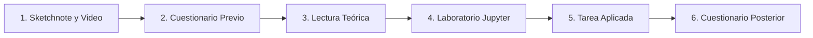

# Guía de Uso del Estudiante

¡Te damos la bienvenida a tu viaje de aprendizaje en **Ciencia de Datos**! Esta guía te orientará sobre la mejor manera de aprovechar cada recurso de este plan de estudios, ya sea que estés estudiando de forma autodidacta o como parte de un curso formal universitario o bootcamp.

---

## Tabla de Contenidos

- [Ruta de Estudio Recomendada por Lección](#ruta-de-estudio-recomendada-por-lección)
- [Cómo Trabajar con los Jupyter Notebooks](#cómo-trabajar-con-los-jupyter-notebooks)
- [Uso de la Aplicación de Cuestionarios](#uso-de-la-aplicación-de-cuestionarios)
- [Consejos para el Aprendizaje Autodidacta](#consejos-para-el-aprendizaje-autodidacta)
- [Consejos para el Trabajo en Equipo y Comunidades](#consejos-para-el-trabajo-en-equipo-y-comunidades)

---

## Ruta de Estudio Recomendada por Lección

Para maximizar tu retención y desarrollar un entendimiento intuitivo y técnico, te recomendamos seguir esta secuencia de 6 pasos en cada una de las 20 lecciones:

1. **Explora la Sketchnote y mira el video**: 
   - Cada lección comienza con un resumen visual dibujado a mano (*sketchnote*). Dedica 2 minutos a observar las conexiones entre conceptos.
   - Si la lección cuenta con video introductorio, míralo para obtener el contexto general.
2. **Presenta el Cuestionario Previo (*Pre-lecture quiz*)**:
   - Responde las 3 preguntas antes de leer el contenido. No te preocupes si no conoces las respuestas; el propósito es activar tu curiosidad y señalarte en qué prestar atención.
3. **Lee la Lección Teórica**:
   - Lee con detenimiento las explicaciones conceptuales y matemáticas en el `README.md` de la lección.
   - Presta especial atención a la terminología técnica estándar (*DataFrames*, *Outliers*, *Overfitting*, *Pipelines*).
4. **Ejecuta y Experimenta en el Jupyter Notebook**:
   - Abre el archivo `notebook.ipynb` de la lección.
   - Ejecuta las celdas una por una con `Shift + Enter`.
   - Modifica parámetros, cambia colores de gráficos, filtra diferentes columnas y observa qué ocurre. La experimentación activa es el secreto para consolidar el aprendizaje.
5. **Completa la Tarea / Proyecto (`assignment.md`)**:
   - Resuelve el reto propuesto aplicando lo aprendido a un nuevo escenario o conjunto de datos.
   - Escribe tus conclusiones con espíritu crítico. En ciencia de datos, los números por sí solos no dicen nada si no los interpretas en su contexto real.
6. **Consolida con el Cuestionario Posterior (*Post-lecture quiz*)**:
   - Presenta el cuestionario final para comprobar tu comprensión y reforzar los conceptos clave.

---

## Cómo Trabajar con los Jupyter Notebooks

Los cuadernos de Jupyter combinan texto explicativo en formato Markdown con celdas ejecutables de código Python.

### Atajos de Teclado Fundamentales
- `Shift + Enter`: Ejecuta la celda actual y pasa a la siguiente celda.
- `Ctrl + Enter`: Ejecuta la celda actual manteniéndote en ella.
- `A` (en modo comando, tecla `Esc`): Inserta una celda vacía arriba (*Above*).
- `B` (en modo comando, tecla `Esc`): Inserta una celda vacía abajo (*Below*).
- `M` (en modo comando): Convierte la celda a Markdown (texto explicativo).
- `Y` (en modo comando): Convierte la celda a Código Python.
- `D + D` (presionar dos veces D): Elimina la celda seleccionada.

---

## Uso de la Aplicación de Cuestionarios

Cada lección incluye enlaces directos a cuestionarios web interactivos en español:
- Los enlaces en cada lección están preconfigurados con el parámetro `?loc=es` para mostrarse en español latinoamericano.
- Si prefieres ejecutar la aplicación localmente sin conexión a Internet, dirígete a la carpeta [`quiz-app/`](quiz-app/) y sigue las instrucciones del archivo `README.md` correspondiente.

---

## Consejos para el Aprendizaje Autodidacta

1. **Constancia sobre velocidad**: Es infinitamente más efectivo dedicar 45 minutos diarios que intentar estudiar 10 horas seguidas el fin de semana.
2. **Crea tu propio repositorio de soluciones**: Haz un fork de este repositorio y sube tus cuadernos completados con tus propias anotaciones, experimentos y variantes de código. Servirá como tu primer portafolio en GitHub para mostrar a reclutadores y empleadores.
3. **No copies y pegues ciegamente**: Cuando veas código en las lecciones, teclea los comandos manualmente al principio. Desarrollar memoria muscular y familiaridad con la sintaxis de Pandas y Scikit-learn acelera drásticamente tu fluidez.

---

## Consejos para el Trabajo en Equipo y Comunidades

- **Grupos de estudio**: Si estás estudiando con amigos o colegas, organicen sesiones semanales para revisar juntos la tarea de la semana y comparar sus visualizaciones y modelos.
- **Comparte en redes**: Comparte tus gráficos e insights en LinkedIn o X (Twitter) usando los hashtags `#CienciaDeDatos` y `#DataScience`. Explicar lo que aprendiste a otros es la mejor prueba de que realmente lo dominas.
